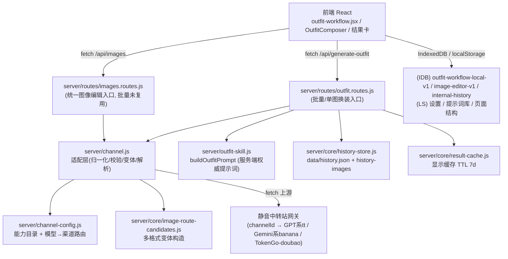
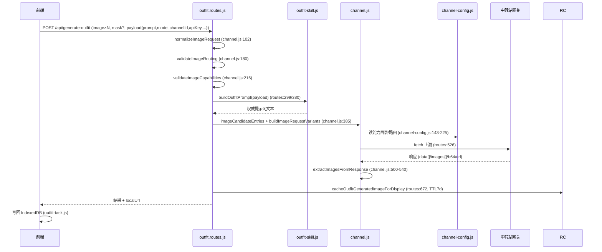
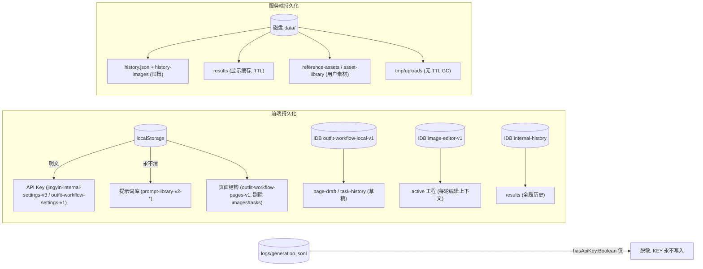

# V11-P0-A：源码审计与 MVO 实施拆解

> 本文档是《静音 AI 画板 V11：AI 画板与电商换装能力升级实施方案 V1.0》（`docs/ai-tryon/升级实施方案-V11-电商换装能力升级.md`）P0 阶段的** consolidated 交付物**。
> 它在既有 P0-A 证据底稿（`EVIDENCE.md` S1–S16）、状态层（`STATUS.md`/`NEXT.md`/`DECISIONS.md`/`README.md`）与已起草的契约/ADR（`contracts/`、`adr/`、`tasks/`）基础上，补齐方案 §9 要求的其余 P0 交付物：架构与调用链路图、能力对照表、问题清单、MVO 实施计划、P0-B 待验证清单。
> 本文档**只做审计、拆解与计划，不含任何代码修改**。未经用户确认，不进入 P1。

---

## 0. 文档关系与阅读指引

| 文档 | 角色 | 与本文关系 |
|---|---|---|
| `升级实施方案-V11-电商换装能力升级.md` | 总战略（P0→P5） | 审计与目标依据 |
| `EVIDENCE.md` | P0-A 证据底稿（S1–S16，带 file:line） | 本文 §2–§4 的证据基座；行号修正见 §7 |
| `STATUS.md` / `NEXT.md` | 当前阶段与下一任务 | 本文为 P0-A 收官报告，下一任务仍为 P0-B（暂停·等样本） |
| `contracts/`（tryon-task / state-machine / prompt-template-v1 / log-fields / garment-profile / quality-report / interfaces） | P1/P2/P4 设计契约 | 本文 §5 的接口/数据落点直接复用 |
| `adr/`（ADR-001 维持内聚架构 / ADR-005 模型路由与能力声明来源） | 架构裁定草案 | 本文 §5 沿用其结论 |
| `tasks/`（T-001 / T-002） | 切片任务契约 | 本文 §5 阶段拆分参照 |

---

## 1. 执行边界与约束遵守声明

本任务严格遵守《升级实施方案-V11》§2.3 禁止项与任务 §二 十项约束。自查如下：

| 约束 | 是否遵守 | 说明 |
|---|---|---|
| P0-B 模型实验暂停、不消耗图像额度 | ✅ | 全程零模型调用、零样本生成；仅静态读源码 |
| 不删除/覆盖/重置用户数据 | ✅ | 未触碰任何用户文件、IDB、localStorage；仅读 |
| 不改 API Key / 模型配置 / 提示词模板 | ✅ | 仅读 `channel-config.js`、`prompts/`、`localStorage` 键定义 |
| 不破坏批量换装、蒙版换装、任务历史、本地启动 | ✅ | 未改动任何业务代码 |
| 不为拆分而做收益不明重构 | ✅ | 仅描述现状，未发起 V5.0 之外的重构 |
| 不把推测写成已确认问题 | ✅ | 凡需实测的项一律标「待 P0-B 验证」 |
| 不把前置卫生工作误记为正式 P0 | ✅ | 明确区分：`V5.0-001~013` 属代码卫生，非本方案 P0 正式交付；本文才是方案 P0 交付物 |
| 优先复用现有模块、不提前引框架 | ✅ | 计划全部建立在现有 `channel.js`/`outfit-skill.js` 之上 |
| 以审计+计划为主，必要时先记录验证方案 | ✅ | 见 §4.2 / §6 验证方案 |

**本任务不授权进入全面重构，也不自动授权开始 P1。** 完成后提交本报告并暂停，等待用户确认。

---

## 2. 当前架构与调用链路

### 2.1 前后端模块关系



### 2.2 模型调用流程（单图/批量共用底层）



- **前端发起**：`outfit-batch-execution.js:393` `generateOutfit(form)` → `src/api/outfit.js:18-20`（写死 `/api/generate-outfit`）→ `src/api/client.js:286` `postForm` → `client.js:227` `fetch()`。
- **后端路由**：`server/routes/outfit.routes.js:134-138`。
- **统一适配层（事实上的统一入口）**：`server/channel.js` + `server/channel-config.js` + `server/core/image-route-candidates.js`。所有图片端点共用；本地不重写上游模型名，由网关按 `channelId` 路由（`channel-config.js:455-458` `upstreamModelForChannel`，其 `modelAliases` 为空 `{}` 于 `:421`）。
- **真实模型 ID 与上游**：`src/shared/models.js:7-78` — `tt-image-2` / `tt-image-2.5`（GPT 系）、`banana-2` / `banana-2.1` / `nano-banana-pro`（Gemini 系）、`doubao`（TokenGo）。注意策略文档用「GPT/Gemini」作泛指，真实接入名如上。
- **错误/超时/重试**：
  - 超时：`IMAGE_CHANNEL_ATTEMPT_TIMEOUT_MS` 默认 360000ms（`runtime-config.js:17-20`）→ `createAbortSignal`（`outfit.routes.js:492`）→ AbortError 映射 504 `channel_timeout`（`:716-717`）。
  - 重试：变体+渠道两级 `baseLoop`（`:482-483`）+ `requestVariants`（`:488`），按 `shouldTryNextImageVariant`（`:607`）/ `shouldTryNextChannel`（`:608,730`）线性回退；**无指数退避、前端无重试按钮**。
  - 错误分类：`server/core/image-error-policy.js:156-205`（auth/quota/tooLarge/permission/manualChannelNotFound/...）。
- **结果处理**：`extractImagesFromResponse`（`channel.js:500-540`）解析多形态响应；`cacheOutfitGeneratedImageForDisplay`（`outfit.routes.js:672`）落地缓存；前端再贴回/自动存 IDB。

### 2.3 批量换装流程

```mermaid
flowchart TD
  A[用户选 A模特+B服装+参考图] --> B[startBatch (outfit-batch-execution.js:629)]
  B --> C[buildTasks (:111) 构造 N 个 task, taskId(:328), routingFields(:331)]
  C --> D[素材组织: modelItem/clothingItem/referenceItems (:122-176), pairingMode(:167)]
  D --> E[前端发 settings.prompt 原文 + outfitIntent(:334/339)]
  E --> F[服务端 buildOutfitPrompt 权威构建 (outfit-skill.js)]
  F --> G[前端 worker 池并发 (startBatch:699-717) + 服务端槽位 acquireImageSlot(:440, IMAGE_CONCURRENCY_LIMIT=5)]
  G --> H[每 worker 独立 try/catch (:723-759) → /api/generate-outfit]
  H --> I{成功?}
  I -->|是| J[autoSaveTask → data/results (:601); 可选写历史]
  I -->|否| K[failedPatch + stageDetail (:737-752); 不中断整批]
  J --> L[前端写 IDB 任务历史 (outfit-task.js:675)]
  K --> L
  L --> M[刷新恢复: readTaskHistory(:665)→recoverPersistedTask(:601)→detachPersistedTask(:605-607)]
```

- **任务创建/素材/模型选择**：与单图同一 `settings` 路径，无分支（`routingFields` 每任务带 model/channelId）。
- **并发**：双层——前端 worker 池 + 服务端 `IMAGE_CONCURRENCY_LIMIT=5`（`runtime-config.js:35`）+ `drainImageQueue`（`image-concurrency.js:15-29`）。
- **失败隔离**：单张失败写 `failedPatch`、标 `stageDetail`，**不影响整批**；200 无图抛 `describeEmptyResult`（`:400-405`）。
- **历史**：服务端 `appendHistoryResults`（`history-store.js:376`）+ `archiveIncomingHistoryItem`（`:355` → `data/history-images`）。**关键缺口**：批量接口自身不写历史（`outfit.routes.js:402` 注释确认 `persistGeneratedItemsInBackground` 仅 `/api/images` 调用），批量历史依赖前端 IDB。
- **保存/恢复**：原图只读（`resolveLocalEditBaseFile :413/:542`），输出为新文件；恢复为**纯前端维度**（服务端无任务持久，刷新即丢服务端状态）。

### 2.4 蒙版换装流程

```mermaid
flowchart TD
  A[用户在本地画布涂抹 maskCanvasRef 白色不透明] --> B[local-edit-mask.js:15/374-387 → canvasToPngDataUrl(:533)]
  B --> C[alpha 反转: 涂抹区透明/其余不透明 (:273-288) + 8px feather (:292)]
  C --> D[createInpaintUploadMask 按 cropRect 裁到上传同尺寸 (:254-268)]
  D --> E[转 PNG File → form.append('mask',...) (outfit-batch-execution.js:369-370)]
  E --> F{服务端 gate: outfit.routes.js:210-211}
  F -->|outpaintWorkflow || payload.maskEdit| G[maskFile 透传]
  F -->|标准换装且无 maskEdit| H[maskFile = null (S6)]
  G --> I[buildEditImageForm 所有模型统一 append mask (channel.js:341/380)]
  I --> J[上游 /images/edits (image-channel-candidates.js:46)]
  J --> K[返回生成图]
  K --> L[composeLocalPasteBlob 与非编辑区合成 (outfit-image-pipeline.js:128-142)]
```

- **蒙版数据结构**：canvas 涂抹 → PNG dataURL → IDB（`outfit-page-actions.js:670,712`、`use-outfit-uploads.js:326`）。
- **尺寸关系**：`createInpaintUploadMask` 用 `cropRect` 将全图蒙版裁到与上传 `cropFile` 同框同尺寸（`local-edit-mask.js:254-268`）。
- **坐标/格式转换**：发送前 alpha 反转 + 8px feather（无灰度化）。
- **是否真正传入 API**：`maskFile` 非空 ⇔ `outpaintWorkflow` 或 `payload.maskEdit` 为真（`:210-211`）。`payload.maskEdit = Boolean(inpaintMaskFile)`（`outfit-batch-execution.js:353`），仅当 `localEdit.editMode==="mask"` 且 `maskDataUrl` 存在（`:294-303`）。
- **⚠️ 单图路径断点**：`src/outfit-workflow.jsx` 经 grep **零 `maskEdit` 接线**（已核实）。即单图标准换装无法走蒙版局部编辑，蒙版仅批量路径（或扩图）生效。
- **逐模型适配**：`channel-config.js` 经 grep **零 mask 语义处理**；仅统一 append + 通道选择（`nano-banana-pro` 带 mask 时跳过 JSON image_urls 通道 `channel.js:410`、强制走 edits `image-channel-candidates.js:46`）。**不支持蒙版的模型无显式兜底**（mask 仅作 multipart 多余字段，上游是否遵守未知）。
- **后处理**：`createLocalEditAlphaMask`（feather 16，`local-edit-mask.js:187-230`）+ `composeLocalPasteBlob` 合成。
- **待 P0-B**：上游是否真遵守「不透明=保留 / 透明=重绘」语义（E1）。

### 2.5 数据持久化关系



---

## 3. 现有能力对照表

状态图例：✅已确认具备 ｜ 🟡部分具备 ｜ ❌已确认缺失 ｜ ❓尚待验证（P0-B）

| 能力 | 当前实现位置 | 状态 | 证据(file:line) | 是否需修改 | 建议 |
|---|---|---|---|---|---|
| 模型调用（单图/批量）统一适配层 | `server/channel.js`+`channel-config.js`+`image-route-candidates.js` | ✅ | A 报告 | 否 | P1 直接复用为统一入口 |
| 多图（A+B+参考）传输 | `outfit-batch-execution.js:365,380,390` | ✅ | S3 | 否 | — |
| 双图自动走 `/images/edits` | `channel.js:55` | ✅ | S4 | 否 | — |
| 模型能力声明目录 | `channel-config.js:143-225` | ✅ | S2 | 否（扩展） | P1 补三态标注 |
| 超时处理 | `runtime-config.js:17-20`+`outfit.routes.js:492,716-717` | ✅ | A 报告 | 否 | — |
| 服务端跨渠道/变体回退重试 | `channel.js:482-483,488,607,608,730` | ✅ | A 报告 | 否 | 补指数退避可选 |
| 前端用户侧重试按钮 | 无 | ❌ | A 报告 | 优化 | P1/P2 增强 UX |
| 服务端权威提示词构建 | `outfit-skill.js`→`outfit.routes.js:299,380` | ✅ | B/E 报告 | 否 | P1 冻结模板版本 |
| 批量任务创建/并发/失败隔离 | `outfit-batch-execution.js`+`image-concurrency.js` | ✅ | B 报告 | 否 | — |
| 批量历史服务端落盘 | `history-store.js:376,355` | 🟡 | B 报告 | 是（缺口） | 批量接口应复用 `/api/images` 历史写入 |
| 任务刷新恢复（前端维度） | `outfit-task.js:601,665` | ✅ | B 报告 | 否 | — |
| 蒙版数据结构/尺寸对齐/格式转换 | `local-edit-mask.js` | ✅ | C 报告 | 否 | — |
| 蒙版传入 API（批量/扩图路径） | `outfit.routes.js:210-211,395` | ✅ | S5/S6 | 否 | — |
| **单图路径蒙版接线** | `src/outfit-workflow.jsx` | ❌ | C 报告(grep 0) | **是** | P2/P3 接 `maskEdit` |
| 逐模型蒙版语义适配 | `channel-config.js` | ❌ | C 报告(grep 0) | 待 P0-B | ADR-002 决定路线 |
| 蒙版输出后处理合成 | `outfit-image-pipeline.js:128-142` | ✅ | C 报告 | 否 | — |
| **图片版本模型（版本号/树/关联）** | 全局 | ❌ | D 报告(grep 0) | **是** | P2 新增 |
| 当前图/当前版本标识 | 全局 | ❌ | D 报告 | **是** | P2 新增 |
| 每轮编辑上下文持久化 | `outfit-task.js`(task 级) | 🟡 | D 报告 | 是 | 扩为版本链 |
| 版本历史浏览/比较/回退 UI | 全局 | ❌ | D 报告(grep 0) | **是** | P2 新增 |
| 生成失败安全（不覆盖成功结果/原图） | `outfit-task.js:623`,`outfit-task-retry.js:73,84` | ✅ | D 报告 | 否 | — |
| Skill 加载/选择/执行骨架 | `server/outfit-skill.js`,`detail-ai.js` | ❌(仅提示词) | E 报告 | **是** | P3 建 registry+orchestrator |
| 结果质量评估真实执行 | `server/outfit-quality-ai.js` | ✅(游离) | E 报告 | 是 | P3 收编为 Skill |
| 连续图像编辑 Skill | 无 | ❌ | E 报告 | 是 | P3 新增 |
| 统一 Agent 编排入口 | 无 | ❌ | E 报告 | 是 | P3 新增 |
| 提示词模板存放/加载 | `prompts/`+`prompt-library.js` | ✅ | E/F 报告 | 否 | — |
| API Key 服务端不落盘 | `outfit.routes.js:147`+日志脱敏 | ✅ | S15/F | 否 | — |
| **API Key 浏览器明文 localStorage** | `app-defaults.js:4` | ❓风险 | F 报告 | 优化 | 改 session/内存 |
| 用户提示词「永不清」 | `storage-store.js:66-82` | ✅ | F 报告 | 否 | — |
| 发布重置清 IDB 草稿 | `storage-store.js:45,55` | ❓风险 | F 报告 | 优化 | 排除草稿库 |
| 上传临时文件 TTL GC | `tmp/uploads` | 🟡 | S12/F | 优化 | P1 任务对象化时补 |
| 服装档案（SKU/基准/版本） | 无 | ❌ | 能力表 | 是 | P2 新增 |
| 后处理校色/边缘融合 | 仅基础合成 | 🟡 | 能力表 | 是 | P4 |
| 质量报告/失败分级 | 无 | ❌ | 能力表 | 是 | P4 |

---

## 4. 问题清单

问题分类：🔴已确认问题 ｜ 🟡待验证问题（P0-B） ｜ ⚫能力缺失 ｜ 🔵优化建议

### 4.1 已确认问题（🔴 有源码/运行证据）

**P-01 单图标准换装无法走蒙版局部编辑**
- 路径与函数：`src/outfit-workflow.jsx`（grep `maskEdit` 零匹配）；蒙版仅 `outfit-batch-execution.js:294-303,353` 在批量路径接线。
- 证据：§2.4 / C 报告。
- 用户影响：用户想对单张图做局部换装/局部修改时，蒙版能力不可用，只能走批量路径或放弃局部约束。
- 数据安全：否。
- 阻塞 MVO：部分（局部编辑体验受限；P3 主改点之一）。
- 处理：P2/P3 在单图路径补 `maskEdit` 接线，复用批量已验证的 mask 透传链路。

**P-02 批量接口不写服务端历史，仅依赖前端 IDB**
- 路径与函数：`server/routes/outfit.routes.js:402` 注释；`history-store.js:376`。
- 证据：§2.3 / B 报告。
- 用户影响：批量结果的服务端历史缺失，跨设备/清前端缓存后历史不可恢复。
- 数据安全：否（不丢已有数据，但新建历史不完整）。
- 阻塞 MVO：否（P4 复用时再统一）。
- 处理：批量路径复用 `/api/images` 的 `persistGeneratedItemsInBackground`，或显式写历史。

**P-03 API Key 以明文存于浏览器 localStorage**
- 路径与函数：`src/shared/app-defaults.js:4`（`jingyin-internal-settings-v3`）、`outfit-storage-keys.js:24`（`jingyin-outfit-workflow-settings-v1`）。
- 证据：§2.5 / F 报告。
- 用户影响：本机磁盘明文存 Key，同机多用户/恶意脚本可读。
- 数据安全：**是（中）**。
- 阻塞 MVO：否。
- 处理：改为 sessionStorage 或内存态 + 用户主动加密；不在本任务范围，列为优化。

**P-04 发布重置会删除两个 IDB 库（含草稿）**
- 路径与函数：`src/features/storage/storage-store.js:45` `deleteDatabase`、`:55` `runPublicReleaseStorageReset`。
- 证据：§2.5 / F 报告。
- 用户影响：公共发布重置会清 `outfit-workflow-local-v1`（page-draft 草稿）与 `image-editor-v1`（编辑工程），但提示词库按 `storage-store.js:66-82` 排除、永不清。
- 数据安全：**是（中）**——丢草稿类用户数据。
- 阻塞 MVO：否（属既有发布行为）。
- 处理：重置白名单显式排除草稿库，或在重置前提示备份。列为优化，不在本任务改动。

**P-05 EVIDENCE.md 行号偏差（文档卫生）**
- 内容：S2 读取器位置误写为 `channel.js:210-231`，实为 `channel-config.js:250,274`；S3/S7 payload 行误 `327-358`/`taskId:331`，实为 `327-364`/`taskId:328`；S8 误 `routing.js:370-375`，实为 `routing.js:404-409`。
- 证据：§7 修正表。
- 用户影响：无功能影响，但审计可追溯性受损。
- 数据安全：否。
- 阻塞 MVO：否。
- 处理：§7 给出修正，已同步修订 `EVIDENCE.md`。

### 4.2 待验证问题（🟡 须 P0-B 或外部 API 文档）

**V-01 上游是否真遵守蒙版语义（不透明=保留/透明=重绘）** — E1；阻塞 P3 人体保护路线（ADR-002 生死题）。
**V-02 双图（A+B）编辑的忠实度与「服装细节/非目标区保持」能力** — E2；决定 MVO 能否成立。
**V-03 逐模型 mask 参数实际生效情况（含不支持 mask 的模型是否静默丢弃）** — E1 顺带；决定 ADR-002 路线。
**V-04 上游真实输入上限（maxInputImages/maxPromptLength 实际值）** — E3 代码侧已完成，上游值待实测。
**V-05 尺寸/可复现性（seed 支持、尺寸约束）** — E4。
**V-06 视觉分析三 AI（pose/quality/master-fit）是否具备像素级分割/区域输出** — E6（既有日志无捷径，须直播抽查）；决定 ADR-001 是否需走选项 C。
**V-07 不同参考图类型（flat_lay/hanger/worn）对上游理解的影响** — E2/E5。
**V-08 中转站对 mask/seed/双图权重的实际处理** — 全部 UNKNOWN，未实测前不得进主路径（总纲 §6.1 三态纪律）。

### 4.3 能力缺失（⚫ 当前项目确无对应功能）

**M-01 图片版本模型整体缺失**（版本号/父子树/关联/当前版本标识）——D 报告确认全局零匹配。MVO 核心基础，P2 必须新增。
**M-02 连续编辑上下文模型缺失**——轮次仅为扁平 `task`，仅 `rerunOf` 弱指针，无结构化「前几轮改了什么/保持什么」。P2 新增。
**M-03 版本历史浏览/比较/回退 UI 缺失**——D 报告确认。P2 新增。
**M-04 Skill 执行骨架缺失**（无 registry / 无 orchestrator / 无 `run()` 契约）——E 报告确认。P3 新增。
**M-05 连续图像编辑 Skill 缺失**——代码无对应实体。P3 新增。
**M-06 主图像编辑 Agent 编排入口缺失**——各路由直连 channel，无意图分发。P3 新增。
**M-07 服装档案（GarmentProfile）缺失**——`contracts/garment-profile.md` 已设计，代码未实现。P2 新增。
**M-08 质量报告/失败分级缺失**——`contracts/quality-report.md` 已设计。P4 新增。
**M-09 后处理校色/边缘融合缺失**——仅基础合成。P4 新增。
**M-10 统一图像编辑入口未被批量复用**——批量走独立 `/api/generate-outfit`，未复用 `/api/images` handler（§2.3）。P4 复用时统一。

### 4.4 优化建议（🔵 现有功能可提升）

**O-01** 批量路径复用 `/api/images` handler（M-10/P-02 一并解决）。
**O-02** 前端加用户侧重试/取消按钮（当前仅服务端回退）。
**O-03** `tmp/uploads` 加 TTL GC（S12 低风险缺口）。
**O-04** API Key 由 localStorage 改 session/内存（P-03）。
**O-05** 发布重置排除草稿 IDB（P-04）。
**O-06** 服务端重试加指数退避（可选）。
**O-07** 模型能力目录补「mask 支持/seed/局部编辑」三态标注（ADR-005）。

---

## 5. MVO 最小实施计划（映射到真实源码路径）

> 以下为**提案**，非已授权执行。每阶段须用户确认后开工，且遵循「审计→计划→确认→回滚点→小改→测试→验收」流程（方案 §11.3）。
> 接口/数据契约直接复用 `contracts/`，架构裁定沿用 `adr/ADR-001`（维持内聚）、`adr/ADR-005`（扩展 channel-config 能力目录）。

### 阶段 P0（本任务，已完成）
- **目标**：查清真实能力、产出审计与计划。
- **范围**：纯文档（`P0-A-源码审计与MVO实施拆解.md` + 更新 `STATUS`/`EVIDENCE`）。
- **可复用**：`EVIDENCE.md`、`contracts/*`、`adr/*`。
- **新增最小能力**：无代码。
- **依赖**：无。
- **风险**：无（零修改）。
- **测试**：门禁 54/54 未被触动。
- **验收**：满足方案 §13 任务 A–E 与本文 §8。
- **回滚**：纯新增文档，删除即回滚。

### 阶段 P1 — 统一图像编辑执行入口
- **目标**：把 `server/channel.js` 固化为单图/批量共用的统一入口，补齐超时/错误/日志字段与能力三态。
- **修改范围**：`server/channel.js`、`server/channel-config.js`（扩能力目录三态，ADR-005）、`server/core/generation-logger.js`（补 task_id/attempt/版本/成本，S10）、`server/routes/images.routes.js`（作为统一 handler）。
- **可复用**：现有 `channel.js` 适配层、`image-error-policy.js` 分类、`tryon-task` 契约（任务记录层轻量附加）。
- **必须新增最小能力**：`resolveModelCapabilities` 三态读取（`interfaces.md`）、`createTryOnTask`/`generateTryOn`/`retryOrRoute` 最小子集（`interfaces.md §4`）、任务记录层 `data/ai-tryon/tasks/<id>.json`（原子写，`tryon-task.md §3`）。
- **依赖**：P0-B 部分结论（V-03/V-04 可选；不影响入口搭建）。
- **风险**：低（仅扩展，不破现有请求路径）。
- **测试**：回归现有生成/批量/蒙版链路 + 门禁。
- **验收**：≥1 条图像编辑路径稳定执行；失败可识别记录；原 API 配置/框架不变；模型差异不被隐藏。
- **回滚**：特性分支 revert；v4.0 tag 保底。

### 阶段 P2 — 单图连续编辑与版本管理
- **目标**：实现 MVO 核心闭环——同一图多轮连续编辑、每轮独立版本、可比较/回退。
- **修改范围**：新增版本数据模型（落 `data/ai-tryon/` 或扩展 IDB `outfit-workflow-local-v1`）；`src/outfit-workflow.jsx`（补 `currentVersion`/`activeVersion` 标识，**含单图 `maskEdit` 接线=P-01**）；结果卡/历史 UI（版本浏览/比较/回退）。
- **可复用**：`outfit-task.js` 的 task 记录、`recoverPersistedTask` 恢复、`garment-profile.md` 契约（P2 服装档案 MVP）；`composeLocalPasteBlob` 合成。
- **必须新增最小能力**：版本标识 + 父版本链（`rerunOf` 升级为版本树）、每轮结构化编辑目标持久化、`GarmentProfile` 本地文件+JSON 索引（`contracts/garment-profile.md`）。
- **依赖**：P1 统一入口。
- **风险**：中（数据模型新增需兼容旧 `page.tasks`）；须保证旧任务不丢（方案 §11.2）。
- **测试**：方案 §12.2 三轮连续编辑（换装→调色→改背景保持服装），刷新后可查看/回退。
- **验收**：同图≥3 轮各生成独立版本并正确关联父版本；刷新后历史可用；失败不覆盖成功结果；模型不支持的约束不被伪装成已保证。
- **回滚**：版本数据独立落盘，旧 `page.tasks` 保留；分支 revert。

### 阶段 P3 — Agent 与三个 Skill
- **目标**：主图像编辑 Agent + 电商服装换装/连续图像编辑/结果检查三 Skill，经统一入口调用。
- **修改范围**：新增 `server/skills/registry.js`（对象表 `{id,inputSchema,outputSchema,run()}`）、`server/agent/orchestrator.js`（意图路由→Skill→channel.js→统一返回）；收编 `outfit-skill.js`+`detail-skills`+`outfit-quality-ai.js`（后者游离，M-04/E 报告）。
- **可复用**：`outfit-intent.js:283 validateOutfitIntent`、`retouch-intent.js` 枚举校验、`detail-ai.js:135 outputSchema` 提升为正式 I/O 契约；`prompts/` 与 `channel.js` 为骨架。
- **必须新增最小能力**：Skill 注册表 + Agent 编排入口 + 连续图像编辑 Skill 定义 + `outfit-quality-ai.js` 收编为结果检查 Skill。
- **依赖**：P1 统一入口、P2 版本模型。
- **风险**：中（新增抽象层，须防「提示词拼接器」陷阱——方案 §4.3）；权限/费用/不可逆操作加确认（方案 §6.4）。
- **测试**：Agent 能识别意图、选 Skill、结果关联正确版本；失败有分类处理。
- **验收**：Agent 识别「换装/局部修改/背景修改」并路由；三 Skill 可调用真实执行；结果可检查。
- **回滚**：新增目录+路由，移除即回滚；不动现有链路。

### 阶段 P4 — 复用到批量换装
- **目标**：把 P1–P3 验证的入口/Agent/Skill 复用于批量，统一历史与失败隔离。
- **修改范围**：`outfit-batch-execution.js`（改用 P1 统一入口 + 复用 `/api/images` 历史写入=P-02/M-10）、批量结果关联版本、并发在 P1 状态机/预算之上优化。
- **可复用**：P1–P3 全部；现有并发槽（`image-concurrency.js`）、失败隔离逻辑。
- **必须新增最小能力**：批量任务状态机（复用并发槽，不新建池）、单图失败不影响整批（已具备）、每张图独立状态/结果/错误追踪。
- **依赖**：P1–P3 稳定。
- **风险**：低–中（复用为主）。
- **测试**：批量不覆盖原素材；单图失败不破坏整批；并发可控；引入 Agent 后资源不无节制增长。
- **验收**：批量复用统一入口；历史/版本/质量报告贯通；性能基线不退化。
- **回滚**：分支 revert。

---

## 6. P0-B 待验证清单（不提前执行，保留预算）

> 沿用 `EVIDENCE.md §三` 实验索引与 `NEXT.md` 恢复前置。预算 **≤50 次生成调用**（用户 2026-10-22 批准，触顶即停）。

| 实验 | 问题 | 所需条件 | 状态 |
|---|---|---|---|
| E1 Mask 语义（生死题） | V-01/V-03：上游是否遵守 mask | 样本 + KEY + 跑 | 待跑（暂停·等样本） |
| E2 双图忠实度 + A 组基线 | V-02/V-07：换装质量 | 样本 + 用户当前提示词填入 `p0-cases.json` | 待跑 |
| E3 输入限制抽查 | V-04：代码侧已完成，上游值待实测 | 不烧额度 | 代码侧完成，上游待抽 |
| E4 尺寸/可复现性 | V-05：seed/尺寸 | 样本 + KEY | 待跑 |
| E5 B 组结构化 Prompt 初探 | V-07：提示词结构 | 样本 + KEY | 待跑 |
| E6 视觉分析可用性 | V-06：pose/quality/master-fit 分割能力 | 直播抽查（不烧生成额度） | 待跑（无日志捷径） |
| E7 成本/限流/稳定性 | 伴随记录 | 伴随 | 伴随 |

**恢复前置（缺一不可，见 NEXT.md）**：①本地服务已起（默认 `http://127.0.0.1:8787`）；②≥4 组样本放 `eval/samples/<ID>/` 并登记；③`p0-cases.json` A 组填入用户当前提示词原文；④用户本机执行（`JINGYIN_PROBE_API_KEY` 环境变量，禁落盘）。

---

## 7. 源码差异修订建议（EVIDENCE 行号修正）

| 原 EVIDENCE 声明 | 实际（已 grep 核实） | 处置 |
|---|---|---|
| S2 读取器 `server/channel.js:210-231` | `validateModelCapabilities`/`routingModelCapabilities` 位于 `channel-config.js:250,274` | 已修正 `EVIDENCE.md` |
| S3/S7 payload `327-358`、`taskId:331` | `outfit-batch-execution.js:327-364`、`taskId:328` | 已修正 `EVIDENCE.md` |
| S8 `routing.js:370-375` | `routingFields` 在 `routing.js:404-409`（`:370-375` 为 `channelsForModel` 分支） | 已修正 `EVIDENCE.md` |
| S3 称「前端编译」提示词 | 服务端 `outfit-skill.js` `buildOutfitPrompt` 权威构建（`routes:299,380`） | 已修正 `EVIDENCE.md` 描述 |

（其余 S1/S4/S5/S6/S9/S10/S11/S12/S13/S14/S15/S16 经核实一致，保留。）

---

## 8. 完成标准自检（对照任务 §六 10 条）

| # | 完成标准 | 是否达成 | 落点 |
|---|---|---|---|
| 1 | 已梳理主要调用链路 | ✅ | §2.1–2.4 |
| 2 | 已查明模型/批量/蒙版换装真实实现 | ✅ | §2.2–2.4、§3 |
| 3 | 已确认连续编辑/版本/Agent-Skill 现状 | ✅ | §2.5、§3（M-01~M-06）、§4.3 |
| 4 | 已整理数据/配置保护清单 | ✅ | §2.5、§3、§4.1(P-03/P-04) |
| 5 | 已区分已确认/待验证问题 | ✅ | §4.1–4.2 |
| 6 | 已给映射真实源码路径的 MVO 计划 | ✅ | §5 |
| 7 | 已明确须等用户样本的问题 | ✅ | §4.2、§6 |
| 8 | 未擅自消耗 P0-B 预算 | ✅ | 零模型调用 |
| 9 | 未破坏用户数据/配置/业务功能 | ✅ | 纯只读审计 |
| 10 | 已更新项目文档与状态记录 | ✅ | 本文 + `STATUS.md` + `EVIDENCE.md` 修正 |

**结论**：P0-A 源码审计与 MVO 实施拆解已完成，所有交付物齐备。**本任务按方案要求暂停，等待用户确认后再进入 P1。** P0-B 实验保持暂停、预算保留，恢复条件见 §6。
