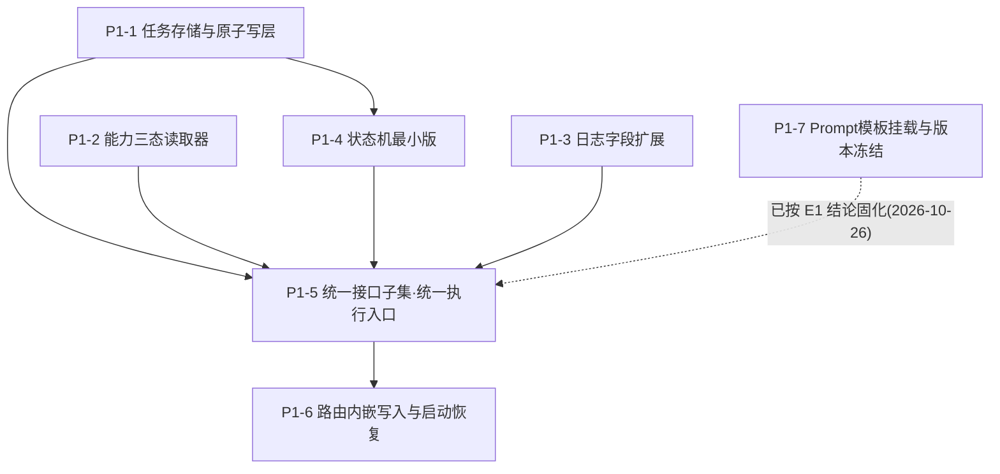

# P1 派发执行单分解总览（统一图像编辑执行入口）

> 分解日期：2026-10-26 ｜ 依据：用户确认《P0-A-源码审计与MVO实施拆解.md》方向后授权拆单。
> 上位文档：`docs/ai-tryon/P0-A-源码审计与MVO实施拆解.md` §5 阶段 P1 ｜ 设计契约：`docs/ai-tryon/contracts/`（tryon-task / state-machine / interfaces / log-fields / prompt-template-v1）｜ 架构裁定：`adr/ADR-005`（扩展现有能力目录，不建平行矩阵）。
> 取代关系：**本分解取代原 `docs/执行单/已完成/2026-10/V4.0-执行单-V129-P1换装任务对象与Prompt版本.md`**（V129 为整包拟稿，含一处依赖 P0-B 的双分支句前置）。V129 保留为历史拟稿，其内容由 P1-1～P1-7 吸收重构，Prompt 双分支句部分隔离至 P1-7。

---

## 1. P1 目标（来自 P0-A §5）

把 `server/channel.js` 固化为单图/批量共用的**统一图像编辑执行入口**，补齐：超时/错误/日志字段与能力三态。不破现有请求路径、不改 API Key/模型配置/提示词模板、不引新框架/数据库、不碰用户数据。

## 2. 拆单原则

- **可独立派发**：每张单范围小、依赖少、验收清晰，可单独开特性分支交付。
- **P0-B 隔离**：凡依赖 P0-B 实测结论的项，单独隔离为 `派发状态=⛔阻塞` 单，不拖住其余 6 张。
- **零依赖叶子纪律**：启动链路/存储链路模块只依赖 node 内置 + `server/core/app-paths.js`，禁入特性模块群（V121-R2 TDZ 铁律）。
- **只增不改语义**：能力目录只增字段、日志只增字段、路由只嵌写入，不改动既有生成参数语义。

## 3. 依赖关系与派发顺序

| 派发序 | 单号 | 标题 | 派发状态 | 依赖 |
|---|---|---|---|---|
| 1 | P1-1 | 任务存储与原子写层 | ✅ 已完成（合入 main） | 无（叶子） |
| 2 | P1-2 | 能力三态读取器 | ✅ 已完成（合入 main） | 无（结构，值待 P0-B） |
| 3 | P1-3 | 日志字段扩展 | ✅ 已完成（合入 main `fb509c2`） | 无 |
| 4 | P1-4 | 状态机最小版 | ✅ 已完成（合入 main `46db7b9`） | P1-1 |
| 5 | P1-5 | 统一接口子集（统一执行入口） | ✅ 已完成（合入 main `739a56e`） | P1-1/P1-2/P1-4（P1-3 记录） |
| 6 | P1-6 | 路由内嵌写入与启动恢复 | ✅ 已完成（合入 main） | P1-1/P1-4/P1-5 |
| 7 | P1-7 | Prompt 模板挂载与版本冻结 | ✅ **已完成**（特性分支 `feature/p1-7-prompt-template-freeze`，提交 `68511a0`/`33e71b0`，**待统筹复核合入 main**） | P1-5（仅双分支句部分） |

## 4. P0-B 门禁结论

- P1-1～P1-6 的**入口骨架与可观测性**不依赖 P0-B 实测值即可建设（能力字段默认 `UNKNOWN`，不进主路径，遵守 `interfaces.md §2` 三态纪律与总纲 §6.1）。
- ~~**P1-7 的双分支句**必须在 P0-B E1（Mask 语义）结论落地后固化（与原 V129 前置②一致），故隔离为阻塞单，不阻塞 P1-1～P1-6 派发。~~
  - ✅ **已于 2026-10-26 解锁**：E1 实测 12/12 通过，结论为基础换装依赖双图身份保持、不依赖掩膜，且精确人体保护掩膜属 P3 ⇒ 双分支句固化到「**不提前承诺掩膜分支；基础换装走双图身份保持，精确人体保护掩膜留 P3 接入**」。代码已落地，待合入 main。
- 批量复用 `/api/images` 历史写入（P-02/M-10）属 **P4**，不在 P1 范围。

## 5. 派发纪律（沿用项目既有）

- 单张派发：建特性分支 → 落实 → 跑门禁（check-syntax 293/293 + run-all --fast 35/35 + ESLint 0 error + 全量 run-all 54/54 + 构建 EXIT=0 + public 首启动冒烟）→ 合并 main → 归档 `docs/执行单/已完成/`。
- `docs/执行单/进行中/` 保持单张在跑纪律；本批 7 张为**暂存待派发**，落 `docs/ai-tryon/执行单/`，不占 `进行中/` 槽位。
- 回滚点：`v4.0` tag（`c0c75b7`）始终保底。
