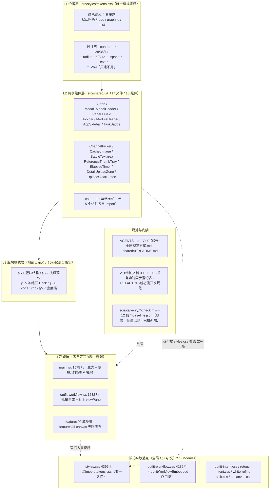
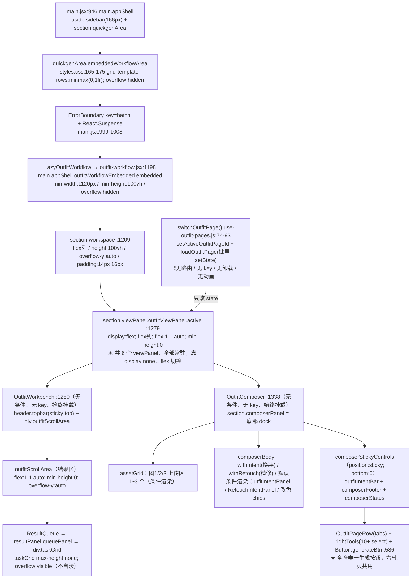

# JY-Canvas V11 · P1-001 交付报告
## 现有 UI 体系审计与批量生成功能页布局统一方案

| 项 | 内容 |
|---|---|
| 派单 | 项目架构负责人 ChatGPT（项目架构 AI） |
| 执行 | 当前负责 Git 源码的 AI |
| 阶段 | **审计与方案设计**（未实施、未改代码）｜**归档时补**：正文为审计阶段快照，实施与最终口径见下方「归档回填」 |
| 日期 | 2026-11-04 |
| 源码基准 | 源码仓根（V11 clone，`jingyin-internal-canvas` v11.0.0）；工作区 C 盘为报告壳，非源码 |
| Git 分支 / HEAD | `codex/feat-mac-release` / `ba94a7b` |
| 工作树 | 仅 1 个既有未跟踪文件 `server/channel.js.bak-20261031-tt25json`；`stash@{0}` 为 RF-047 in-flight。**本次全程只读，未触碰、未 stash pop、未提交、未 push** |
| 交付性质 | 只读审计 + 方案设计。**完成后停止，等待 Owner 确认** |

> 本报告所有路径均为**源码仓相对路径**（遵循 `AGENTS.md` 文档纪律）；行号对应 HEAD `ba94a7b`。所有"方案代码"均为示意，本阶段**不落盘、不实施**。

---

# 归档回填 · 实施结果与口径更正（2026-11-04）

> **本节是唯一现状口径。** 以下正文（§0～附录 B）是 2026-11-04 15:08 的**审计阶段快照**：当时全程只读、HEAD `ba94a7b`、未实施。
> 之后 Owner 确认方案并追加需求，实施已在特性分支 `feature/p1-001-dock-stable-height` 落地；Owner 于 2026-11-04 确认「已执行完成、按后续需求调整过」，本报告按 `AGENTS.md` §43 归档到 `docs/历史交付报告/`，并在 `docs/执行单/README.md` 总表回填。
> **凡正文的「推荐方案 / 预计修改文件范围 / 未实施声明 / 门禁覆盖漂移」与本节冲突，一律以本节为准** —— 防止已被推翻的方案留在仓库里变成新的文档漂移。

## A. 实施提交链

| 提交 | 内容 | 门禁 |
|---|---|---|
| `c969201` | 按报告 A′-1 施工：`.composerPanel` 加 `height:clamp(280px,42vh,60vh)` 给 dock 确定高度、`.composerStickyControls` 加 `margin-top:auto`；既有高度探针改**动态枚举 tab**（正文 §8.4 所述「旧 5 页覆盖漂移」由此消除）、逐页量 4 项 rect、5 档窗口参数化、切页极差在浏览器内算 | check-syntax 347/347、size-ratchet 0 回归、vite build EXIT=0、浏览器探针 55/55 |
| `4eb190c` | **Owner 后续需求调整（最终口径）**：用户反馈「100% 缩放下下方模块要靠滚动查看、结果区下方空一大块、底栏显示不全」⇒ 布局改法重做，详见 B | 见 C |

## B. 最终实现与报告推荐的差异（🔴 以 `4eb190c` 为准）

| 项 | 报告 A′-1 推荐 | 最终实现 | 原因 |
|---|---|---|---|
| dock 高度 | `height:clamp(...)` 固定高 | **弃用 clamp**；`.composerPanel` 改 `flex:1 1 auto; min-height:280px`，`.outfitScrollArea` 改 `flex:0 1 auto` | 固定高在结果图少时留下大块空白；弹性填充让 dock 自动顶高填满结果区下方留白、整块贴底、无需滚动 |
| 生成按钮 | 报告判断「零 JSX 改动」 | `OutfitComposer.jsx` 新增 `.footerTools` 包裹层，把 `.generateBtn` 移出 `overflow-x:auto` 的 `.rightTools` 参数行，独立成 `flex:0 0 auto` 常驻右列（参数行 `flex:1 1 auto; min-width:0` 内部自滚） | 窄屏参数行横滚会把按钮顶出视口（1024 档 `btnBad=114`），「零 JSX」判断被实测推翻 |
| sticky 网格 | — | `.composerStickyControls` 加 `grid-template-columns:minmax(0,1fr)` | 防 auto 列被 nowrap 内容撑宽 |
| 跳动归因 | 归因「dock 高度随内容变化」 | **补充真因**：`overflow-x:auto` 长出横滚条吃掉约 11px 高 ⇒ sticky 顶边 11px 抖动，且只在「部分页溢出」的中间宽度暴露；`.rightTools` 用 `scrollbar-width:none` + `::-webkit-scrollbar{display:none}` 隐藏横滚条（**保留 `overflow-x:auto` 仍可横滚**） | 实测归因补充，宽/窄两端恒定故旧探针测不到 |
| 探针 | 报告建议「5 档 × 动态枚举」 | 再加 **dpr=0.8 校准**：`setViewportSize` 传的是设备像素，名义 1024 实为 1280 CSS px ⇒ 窄屏从未被测到（假绿）；改按 dpr 反算设备像素，并由探针回传 `vw/vh/dpr` 硬断言真实 CSS 视口 ±2px | 用户诉求恰是「100% 缩放」，旧口径下探针全绿无意义 |

## C. 最终门禁（以 `4eb190c` 提交记录为准）

check-syntax **347/347**、size-ratchet **0 回归**、vite build **EXIT=0**、pre-commit 快速子集 **54/54**、`composer-stable-height` 浏览器探针 **66/66**（5 档 × 114 页，全部校准到真 100% 缩放：各极差 0、`btnBad=0`、`composerVisible` 全真、无整页滚动）。
全量 `run-all` **69/75**，6 项失败经干净 HEAD 对照确认均属基线既有失败、无因果链，未据此改代码（对应项目纪律「已知无关失败项」）。

## D. 归档状态与未闭合项

- 分支 `feature/p1-001-dock-stable-height`；**未合入 main、未 push**（沿用既定纪律）。归档由 Owner 明确授权执行，未越权 merge。
- 用户既有未跟踪文件 `server/channel.js.bak-20261031-tt25json` 与 `stash@{0}`（RF-047 in-flight）全程未触碰。
- 正文 §8.4 / §12 步 2 所述「探针页面清单旧 5 页」**已由 `c969201` 动态枚举修复**，不再是遗留项；正文 §9「1024×768 观察档」在 `4eb190c` 已按真 100% 缩放纳入 5 档实测（`btnBad=0`），但**「是否正式扩展支持范围」仍需 Owner 单独决策**（涉 `min-width` 与 V138 结果网格对齐取舍）。
- 仍未闭合：① 7 类文档漂移（正文 §3.3）与 `docs/V4.0-前端UI全局规范方案.md` §4.1 / §5.5 / §11 回填；② 正文 §11 建议的「设计系统变更记录机制化」与 `docs-path-check.mjs` 升级评估（明确不并入本单）；③ **打包二进制须重建**才对使用 SEA 版的用户生效（本单未构建、未做 public 首启动冒烟）。
- 正文 §13「本次禁止项遵守声明」仅描述审计阶段，不适用于后续已获 Owner 确认的实施提交。

## E. 下一单交接

见本报告末尾 **§十四 · 下一单交接清单**（P1-002 候选）。本归档件不预建执行单、不占 `docs/执行单/进行中/` 槽位。

---

## 0. 执行摘要（给 Owner 的 8 条结论）

1. **口径需先对齐**：派单称"六个功能页面"，但当前 Git 里 `seed/manifest.json` 的 `outfit-pages` 是 **7 页**（换装 / 改色 / 精修 / 批量姿态 / 批量换脸 / 固定背景 / 设计稿）；`outfit-workflow.jsx` 里另有 6 个 `viewPanel`（quick/reference/detail/prompt/outfit/resize），那是**另一层**子视图。真正的功能页 tab 由 `outfitPages.map` 全量渲染、数量由用户态 `jingyin-outfit-workflow-pages-v1` 决定 ⇒ **"六页"应是 Owner 当前浏览器状态**。本方案按"页数无关"设计，不依赖具体是 6 页还是 7 页。
2. **现状并非"六页各自布局"**：所有功能页共享同一父级布局（`outfitViewPanel.active` → `OutfitWorkbench` + `OutfitComposer`），切页只是 `setActiveOutfitPageId` + 批量 `setState`，**组件不卸载、不重挂载**；生成按钮**全仓只有一处**（`OutfitComposer.jsx:586`）。因此方案 B "建立共享 Workspace Layout" 在现状下等于重复造一层。
3. **跳动根因**：底部 dock `.composerPanel` 只有 `max-height:60vh` 而**没有确定高度**（`flex:0 0 auto` ⇒ 高度 = 内容自然高度），切页时条件渲染增删内容块使 dock 高度变化；同时它自己是滚动容器，`position:sticky; bottom:0` 的操作条以 dock 为粘性参照系 → 操作条相对视口的位置随内容高度/滚动位置浮动。源码注释已 4 处自认此问题。
4. **已有规范其实够用**：`docs/V4.0-前端UI全局规范方案.md` §5.5「冻结区 Dock」已把目标结构写清楚（单滚动条 + 底部冻结 + 禁止预留双倍高度），缺的是**代码落实**、**文档状态回填**与**门禁覆盖**，不是缺一份新规范。
5. **推荐方案 A′（A 的收敛实现）**：不动 JSX、不动业务逻辑、不新建组件，只改 `src/outfit-workflow.css` 约 2 处规则，给 dock 确定高度 + 让操作条在"内容不足/内容超出"两种情况下都贴 dock 底。改动范围最小、可单文件回滚。
6. **门禁存在覆盖漂移**：`composer-stable-height-check.mjs` / `-page.jsx` 仍在量旧 5 页（含已删除的"随机背景"、已不播种的"批量扩图"），未覆盖改色 / 批量姿态 / 批量换脸 / 设计稿，且只量 `.rightTools` 顶部、只在单一窗口尺寸 ⇒ **可能全绿但覆盖不全**。应扩展既有探针而非新写。
7. **1024×768 属支持范围外**：`.outfitWorkflowEmbedded` 有 `min-width:1120px`（≤1280 时 980px）+ 全局 166px 侧栏 = 最小约 1146px，1024 宽必然横向溢出；强行改 `min-width` 会破坏 V138 结果网格逐像素对齐成果。建议列为"观察档"由 Owner 决策，不纳入本次强制验收（理由见 §9.2）。
8. **本阶段零改动**：未修改 D 盘任何源码 / CSS / 配置 / 用户数据；未新增规范文档（仅本报告一份交付物，落在 C 盘报告工作区）。

---

# 一、开始前检查（派单第二节逐项）

| # | 检查项 | 结论 | 依据 |
|---|---|---|---|
| 1 | Git 分支 / 提交 / 未提交修改 | 分支 `codex/feat-mac-release`，HEAD `ba94a7b`；`git status --short` 仅 `?? server/channel.js.bak-20261031-tt25json`；`diff --stat` 空；`stash@{0}` 为 RF-047 in-flight | `git status/log/diff/stash list` 实测 |
| 2 | AGENTS.md 与维护规范 | **存在**于源码仓根 `AGENTS.md`（12460 B，112 行），非上层 `D:/源码开发/AGENTS.md`（该路径不存在） | `AGENTS.md:1-112`；Glob `**/AGENTS.md` 仅 2 处 |
| 3 | 设计模块拆分 / 公共组件 / UI 规范 | 四层规范 `docs/V4.0-前端UI全局规范方案.md`；令牌 `src/styles/tokens.css`；`src/shared/ui/` 17 文件 16 组件；`src/shared/ui/README.md` | 见 §3 |
| 4 | 重复 UI / 功能同步登记表 | **存在**：`docs/V11维护文档/02-重复功能同步登记表.md`（85 行，24 组登记，5 列表头） | 见 §3.1 |
| 5 | 无限画布布局 / 样式 | `src/features/ai-canvas/` 16 文件 + `ai-canvas.css`；与批量页同挂 `main.appShell > section.quickgenArea`，按 `activeView` **互斥**渲染 | `main.jsx:968/999-1008/1069-1074` |
| 6 | 六个功能页实际组件结构 | 无 6 个独立页面组件；共享 `OutfitWorkbench` + `OutfitComposer`，tab 由 `outfitPages.map` 驱动 | 见 §5 |

**用户现有修改保护声明**：未 `checkout`、未 `reset`、未 `stash pop`、未 `clean`、未写入 `data/`、未读写浏览器 `localStorage`/IndexedDB。用户态 outfit 页/设置属有意状态（记忆中的用户态纪律），本次仅在源码与 seed 层确认其**键名与驱动逻辑**，不读取、不还原、不清空。

---

# 二、交付 1 · 当前 UI 体系结构图



**结构结论**：规范层是完整的四层（T/C/P/F），但**实现层仍是"两大全局 CSS 巨石 + 主组件巨石"**：`styles.css` 4395 行、`outfit-workflow.css` 4189 行、`main.jsx` 1575 行、`outfit-workflow.jsx` 1632 行（`size-ratchet-baseline.json` 锁行数）。`size-ratchet` 与 `frontend-duplication-baseline.json` 把现状作为存量记账，不拦存量、只拦新增。

---

# 三、交付 2 · 现有设计规范与公共组件清单

## 3.1 已经存在的设计规范（不缺规范，缺落实）

| 文档 | 状态 | 关键内容 |
|---|---|---|
| `AGENTS.md` | 有效 | `:24-25` UI 改动先看全局 UI 规范 + 同步登记表；按钮/弹窗/版块外壳一律 `src/shared/ui/`；`:36-43` 文档归口纪律；`:45-61` 基线/棘轮硬门禁；`:63-72` 删除纪律；`:74-112` Git 发布流程 |
| `docs/V4.0-前端UI全局规范方案.md` | 有效，**§4.1 状态表漂移** | 12 节。§2 四层架构(`:36-45`)；§3.1 颜色语义令牌(`:49-51`)、§3.2 换装别名(`:53-62`)、**§3.3 尺寸族**(`:64-74`)；§4.2 Button API 与旧类映射(`:96-114`)、§4.3 `ui.css` 单一来源 + 禁止覆盖 `.ui-*`(`:116-120`)；§5.1 版块结构、§5.2 按钮落位分级、§5.3 栅格间距、§5.4 Field、**:149-163 §5.5 冻结区 Dock**、§5.6 Zone Strip、§5.7 密度档/Park；§6 禁止清单(`:180-185`)；§8 门禁表；§11 已知视觉变更 |
| `src/shared/ui/README.md` | 有效 | `:9-19` 必须优先共用清单；`:21-36` 已抽取 8+ 组件（含"刻意不加 Esc 关闭与 body 滚动锁"）；`:38-44` 修改规则（不能抽就登记同步）；`:46-55` CSS 规则，禁止同一概念多套相似样式 |
| `docs/V11维护文档/02-重复功能同步登记表.md` | 有效，**抬头滞后** | 5 列表头(`重复能力/位置A/位置B/必须同步检查/目标归并位置`)，`:15-38` **24 组**登记（API Key、上传区、结果图库 V140/V141/V142、提示词唯一编译器等）；`:61-75` 已机器化条目 |
| `docs/V11维护文档/00~05` | 存在但 3 份漂移 | `00` 总索引、`:05` 批量分区功能地图（9 tab 口径已过时）等 |
| `docs/存档-台账/REFACTOR-新功能开发规范.md` | 有效 | 硬红线：单文件 ≤600 行、主组件只减不增、单函数 ≤60 行、≤12 `useState`；5 步分层流程；工厂 `createXxx(deps)`；差异参数化、已分叉停手报人 |
| `prompts/README.md` | 有效 | 提示词/SKILL 中心（目录说明，非"AI 角色 SKILL.md"） |

## 3.2 已经存在的公共组件（`src/shared/ui/`，17 文件 / 15 jsx / 16 组件）

| 类别 | 组件（文件） | 覆盖 |
|---|---|---|
| **按钮** | `Button`（`size=sm 28/md 36/lg 44`、`tone`、`iconOnly`、`loading`、`active`、`disabled`） | 27+ 业务文件；旧 11 类按钮**已归零**（`legacy-button-baseline.json` = 0） |
| **弹窗** | `Modal` + `ModalHeader` | 11 / 5 文件 |
| **版块外壳** | `Panel`、`ModuleHeader`、`Toolbar` | 2 / 12 / 2 文件 |
| **表单** | `Field`（label/hint 三段式）、`StableTextarea`（memo 受控）、`ChannelPicker`（渠道下拉） | 2 / 3 / 2 |
| **上传/图** | `DetailUploadZone`、`UploadClearButton`、`ReferenceThumbTray`、`CachedImage` | 2 / 5 / 4 / 6 |
| **状态** | `TaskBadge`、`ElapsedTimer`、（仓外）`src/shared/error-boundary.jsx` | 3 / 3 / 1 |
| **导航** | `AppSidebar` | 1（主壳） |

**CSS/令牌**：全仓 8 个 `.css`（`styles.css` / `styles/tokens.css` / `shared/ui/ui.css` / `outfit-workflow.css` / 3 个 outfit feature css / `ai-canvas.css`），**零 CSS Modules**；唯一入口 `main.jsx:55 import "./styles.css"` → `styles.css:1 @import "./styles/tokens.css"`。`tokens.css` 约 37 个唯一变量、96 行定义、4 套主题，业务侧约 1053 处 `var(--)` 引用（颜色语义接入良好）；**尺寸族"只建不用"**（`tokens.css:41` 自注 V69 只建不用）。

**图标**：`lucide-react`（40 文件），无统一 `Icon` 组件；`¥` 字形图标在 `ChannelPicker.jsx:131` 与 `main-canvas-board.jsx:361` 各手写一份。

**状态组件**：**无**统一 Toast / Loading 组件。Loading 至少 3 套（`main.jsx:88-92` Suspense 占位、5 处内联 `loadingCard`、`Button.jsx:45` 内置 spin）；错误提示 4-5 套（`.connectionHint`/`.fieldHint`/`aiCanvasNotice`/`Field hint`/`ErrorBoundary`）；Toast 仅换装页 `.composerStatus` 私有状态条。

**门禁**：`shared-ui-duplication-check`、`frontend-duplication-check`、`ui-duplication-check`、`legacy-button-ratchet-check`、`hardcoded-color-check`、`size-ratchet-check`、`modal-shell-check`、**`composer-stable-height-check`** 等，配套 12 份 baseline（棘轮语义：存量记账、`stale` 判红、只拦新增）。

## 3.3 已确认的文档/规范漂移（7 类，不新增文档即可修）

| # | 漂移 | 证据 |
|---|---|---|
| D1 | `00-总索引.md:46-89` 9 处写死**本机不存在的**上游绝对路径 `D:\静音AI绘画V11（源码）` | `AGENTS.md:5/49/56` 明令禁止；`docs-path-check.mjs` 自述"告警型、退出码恒 0"故未拦下 |
| D2 | `01-目录分区与维护地图.md:13/226`、`03-Codex提问模板.md:8/17-19` 同类死路径 | 同上 |
| D3 | `01:43` 仍写"无限画布 `src/main.jsx`、默认隐藏"，实际已落地 `src/features/ai-canvas/`（16 文件）且 `main.jsx:1069` 正常渲染；`02` 登记表 24 行**未登记无限画布** | Agent 勘查 |
| D4 | `05:15` 仍把"批量改色"映射到 `workflows/recolor/`，而 `workflows/README.md:29` 明确 `recolor` 已退役由 `custom` 承接 | 两文档互相矛盾 |
| D5 | 全局 UI 规范 §4.1(`:89-91`) 仍把 `Button/Toolbar/Field/Panel/ModuleHeader` 标"待建"，`shared/ui/README.md:26-30` 已记建成 | 状态未回填 |
| D6 | `02` 抬头"最后复核日 2026-10-19（V114）"，表体已含 V138/V140/V141/V142 修订 | 抬头滞后 |
| D7 | `outfit-workflow.css:2544-2545` 注释写 `.composerPanel` 是 `flex:0 1 auto`，代码 `:2208` 实为 `flex:0 0 auto`；`.outfitIntentBar` 在 `outfit-workflow.css:3003`(22px) 与 `outfit-intent.css:274`(32px) **两套定义** | 注释/代码口径漂移 |

---

# 四、交付 3 · 当前 UI 不一致问题清单

## 4.1 六项盘点结论（派单第三节要求）

**① 已经存在的设计规范**：四层 T/C/P/F 架构、颜色语义令牌、Button API、版块标准结构、冻结区 Dock、Zone Strip、密度档/Park、禁止清单、文档归口、5 套棘轮门禁 —— 见 §3.1。**规范密度高于行业平均，不缺文档。**

**② 已经存在的公共组件**：16 个（§3.2），Button 收口最彻底，Modal/ModuleHeader/CachedImage 已成事实标准。

**③ 当前缺失的规范**（仅 4 项，且都可在既有文档内补齐）：
- **布局规范的落地验收口径**：§5.5 写了"冻结区贴底常驻"，但没有定义"贴底"的可测量断言（哪个元素、相对什么、允许多少 px、哪些窗口尺寸）。
- **响应式断点表**：全仓仅 3 处 `@media`（`outfit-workflow.css:2036` 1280、`styles.css:3981` 1180、`styles.css:4025` 760），无断点/最小支持尺寸/降级策略的成文约定。
- **动效规范**：全仓 `prefers-reduced-motion` **0 命中**；无 duration/easing 令牌；无"切换动效不得影响布局属性"的约束。
- **设计系统变更记录**：不存在专门文件；职能散在全局 UI 规范 §11「已知视觉变更」表与 V69~V106 执行单里。

**④ 重复或不统一的组件**（典型 10 处，均为存量、门禁已记账）：

| # | 现象 | 证据 |
|---|---|---|
| U1 | 页面绕过共享 `Button` 直接写原生 `<button>` | `outfit-workflow.jsx:1226/1230/1245/1249/1565`（`.legacyAction`）；`main.jsx` 22 个 `<button`（右键菜单/预览箭头） |
| U2 | `.ui-*` 被全局 `styles.css` 覆盖 20+ 处，与 `ui.css:3`、`README.md:43` 冲突 | `styles.css:1711/1893/2067-2088/2781-2796/3806` |
| U3 | `ui.css` 被 5 个组件各自 import（同一 CSS 5 个源码入口） | `Button.jsx:11`、`Field.jsx:9`、`ModuleHeader.jsx:9`、`Panel.jsx:8`、`Toolbar.jsx:8` |
| U4 | `loadingCard` 占位 JSX 5 处重复 | `VideoView.jsx:54`、`quick-gallery-card.jsx:58`、`ReferenceRemixView.jsx:215`、`result-card.jsx:48`、`WorkflowQuickVideoPanel.jsx:317` |
| U5 | 结果卡两套分叉 | `features/outfit/panels/result-card.jsx` vs `features/main-app/panels/quick-gallery-card.jsx`（`README.md:16` 仍列"待抽"） |
| U6 | `¥` 字形图标两处手写 | `ChannelPicker.jsx:131`、`main-canvas-board.jsx:361` |
| U7 | 字体族不一致 | `tokens.css:16` `Arial` vs `outfit-workflow.css:15` `system-ui` |
| U8 | 圆角/字号/间距/颜色硬编码绕过令牌 | `styles.css` 89 行 `border-radius:Npx`、99 行 `font-size:Npx`、195 处 hex；`.connectionHint.ok:2656` 硬编码 `#49c85b` 与 `.error:2660` `var(--danger)` 同组件内混用 |
| U9 | 换装别名层 11 个 `--*-bg` 与主令牌重复映射 | `outfit-workflow.css:1-20` |
| U10 | 同名类两套定义 / 注释与代码不符 | `.outfitIntentBar` 22px vs 32px；`composerPanel` 注释 `flex:0 1 auto` vs 代码 `flex:0 0 auto` |

**⑤ 适合继续复用的模块**：`tokens.css` 颜色语义令牌（1053 处引用 + hex 棘轮护栏）、`Button`/`ui.css` 变体矩阵（27+ 文件、旧类归零）、`Modal`/`ModalHeader`、`CachedImage`、`ReferenceThumbTray`、`StableTextarea`、`ModuleHeader`、`TaskBadge`、`ChannelPicker`、整套棘轮门禁基线（`shared-ui-baseline.json` 的 `duplicates` 已为空）。

**⑥ 不建议现在重构的模块**：`styles.css`(4395 行) / `outfit-workflow.css`(4189 行) 两颗巨石（受 size-ratchet 锁定，全量 token 化需真机冒烟）；尺寸族令牌存量接入（89+99 行硬编码，牵动上千选择器）；Toast/Loading/错误提示统一组件（带业务上下文，`Modal.jsx:12-13` 已确立"不加原来没有的行为"）；页面自写 button（多为右键菜单等上下文交互，且 6 个门禁探针依赖选择器）；换装别名层清理；`.ui-*` 覆盖清理（多为有意布局微调，需逐处视觉回归）。

---

# 五、交付 4 · 批量生成功能页专项分析

## 5.0 口径澄清（必须先对齐）

| 概念 | 数量 | 来源 | 是否本次对象 |
|---|---|---|---|
| 功能页 tab（换装/改色/精修/批量姿态/批量换脸/固定背景/设计稿） | **seed 默认 7**，用户态可变（Owner 当前 6） | `seed/manifest.json:221-826`；运行时 `src/features/outfit/outfit-page-actions.js:634-651 readOutfitPages` → `:520-525 ensureWorkflowPages`；`src/features/outfit/outfit-storage-keys.js:26 OUTFIT_PAGES_KEY` | ✅ **是** |
| `viewPanel` 子视图（quick/reference/detail/prompt/outfit/resize） | 6 | `outfit-workflow.jsx:1210/1219/1238/1257/1279/1447` | ❌ 另一层，非"批量六页" |
| 旧文档 9 tab | 9 | `docs/V11维护文档/05-批量分区功能地图.md:7-17` | ❌ 已漂移（随机背景被 `outfit-deleted-modes` 移除、批量改色退役并入 `改色(custom)`、白底精修更名 `精修`、`词` 改独立按钮） |

> `seed/manifest.json:310` 的「改色」页 id 时间戳 `1793560264323` 明显晚于其余 6 个 `1793539952487/88`，是后追加的第 7 页。`outfit-effects.js:296-306` 会把运行期 `outfitPages` 写回用户态键 ⇒ **实际显示页数以 Owner 浏览器为准**。本方案对所有页数同样成立（因为共享同一套 dock）。

## 5.1 组件关系图



## 5.2 DOM 结构树（标注每层关键 CSS）

```
section.quickgenArea.embeddedWorkflowArea            main.jsx:968 / styles.css:165-175
└─ main.appShell.outfitWorkflowEmbedded.embedded     outfit-workflow.jsx:1198 / css:26-31,169-171
   └─ section.workspace                              :1209 / css:153-159,175-189
      └─ section.viewPanel.outfitViewPanel.active    :1279 / css:2228-2235  flex列 flex:1 min-height:0
         ├─ header.topbar                            OutfitWorkbench.jsx:89  order:0 sticky top
         ├─ div.outfitScrollArea 【结果区】            css:2237-2248  order:2 flex:1 min-height:0 overflow-y:auto
         │  └─ resultPanel.queuePanel > div.taskGrid  css:685-698  max-height:none overflow:visible
         │     └─ article.assetCard (aspect-ratio:3/4) 图片加载不撑高
         └─ section.composerPanel 【底部 dock】         css:2202-2225  order:3 flex:0 0 auto
            │                                         max-height:60vh（❗无 height）overflow-y:auto
            ├─ section.assetGrid（1~3 个上传区）        css:3025-3035  2fr:1fr:1fr
            ├─ div.composerHeader（display:none）       css:2549-2551
            ├─ div.composerBody[withIntent|withRetouch] outfit-intent.css:25-39 / retouch-intent.css:145-152
            │  └─ 2× textarea：clamp(44px,6vh,60px) / 精修固定 168px
            └─ div.composerStickyControls              css:2251-2266  sticky bottom:0  grid
               ├─ outfitIntentBar   min-height:32px（outfit-intent.css:283）+ 占位
               ├─ composerFooter    css:2537-2547  padding:10px 0 18px
               │  ├─ OutfitPageRow → outfitPageDock（overflow-x:auto, tab 由 outfitPages.map）
               │  └─ rightTools（nowrap + overflow-x:auto）→ Button.generateBtn  :586
               └─ composerStatus   min-height:36px + visibility:hidden 占位   css:3007-3020
```

## 5.3 十问十答（派单第四节全部 10 项）

| # | 问题 | 结论 | 源码依据 |
|---|---|---|---|
| 1 | 六页是否共享同一父级布局？ | **是**。全部共享 `outfitViewPanel.active` → `OutfitWorkbench` + `OutfitComposer`，无独立页面组件 | `main.jsx:999-1008`、`outfit-workflow.jsx:1198/1209/1279/1280/1338` |
| 2 | 切页是否重新挂载整个页面？ | **否**。纯 `setState`，`.viewPanel` 全部常驻（`display:none↔block/flex`），无 `key`、无路由、无卸载 | `use-outfit-pages.js:74-93`、`outfit-page-switch.js:80-100`、`outfit-workflow.css:197-204`；全文件 `key={` 仅 `:1595`（标注弹窗）；`main.jsx:1000 key="batch"` 为常量 |
| 3 | 底部按钮是否各页独立渲染？ | **否，全仓仅一处**。`OutfitComposer.jsx:586` 的 `Button.generateBtn`；六/七页共用 | `grep generateBtn` 仅命中 `OutfitComposer.jsx:586`(渲染)、`outfit-workflow.css:2621`(CSS)、`outfit-batch-execution.js:638`(startBatch 定义) |
| 4 | 底部操作区高度变化来自什么？ | 来自 **`.composerPanel` 高度 = 内容自然高度**（`flex:0 0 auto` + 只有 `max-height:60vh`、无 `height`）；切页时 `OutfitComposer` 条件块增删改变内容高度 | `outfit-workflow.css:2202-2225`；条件渲染点 `OutfitComposer.jsx:170/202/240/259/275/347/365`；差异 CSS `retouch-intent.css:154-177`(168px)、`outfit-intent.css:31-33`(两栏)、`outfit-workflow.css:2571-2585`(clamp) |
| 5 | 各页 margin/padding/gap/height/min-height 不一致？ | **CSS 规则完全一致**（全仓无按 workflowMode 区分的选择器，grep `pose-remix/face-swap/...` 零命中）；**不一致来自条件渲染的 DOM 块数量与形态**：上传区 3↔1、意图面板 2 栏↔单栏、textarea 60px↔168px | `OutfitComposer.jsx:138-421`；`outfit-workflow.css:3025-3035/2566-2585`；`outfit-intent.css:25-39`；`retouch-intent.css:9-20,145-177` |
| 6 | 内容撑高父级导致底部被挤动？ | **是（核心）**。dock 是 flex 列末项且高度内容驱动；内容变高 → dock 顶边/内部 sticky 条上移；同时 `.workspace` 自身 `overflow-y:auto`，极端情况下整列超出视口产生外层滚动 | `outfit-workflow.css:2208/2214/2219`、`:2228-2235`、`:175-189`；源码自认注释 `:2253-2256`、`:2542-2545`、`:2591-2595` |
| 7 | 切页时布局重算 / 异步内容导致跳动？ | **同步重算有，异步加载无动画**。切页 → `workflowMode` 派生翻转 → 条件块增删 → 栅格列模板/textarea 高度切换 → dock 高度变化。图片用 `aspect-ratio:3/4` 固定占位、`loadingCard` 静态无 shimmer、`inlineMessage`/摘要条已有恒高占位（`min-height:36px`/`32px` + `visibility:hidden`），**未找到** `onLoad` 改尺寸 / 骨架屏 / 进度条插入 | `outfit-workflow.jsx:391-401`、`outfit-workflow.css:700-711/3001-3020`、`result-card.jsx:225-238` |
| 8 | 结果图区域是否独立滚动？ | **部分**：`taskGrid` 明确不自滚（`max-height:none; overflow:visible`），滚动由外层 `.outfitScrollArea`（`flex:1 1 auto; min-height:0; overflow-y:auto`）承担 —— 结果数量增加**只影响结果区内部滚动**，不会顶走 dock | `outfit-workflow.css:685-698`（注释写明"共用外面一条滚动条"）、`:2237-2248`、`ResultQueue.jsx:109-110` |
| 9 | 非全屏 / 窗口缩小时哪些区域溢出？ | ① `.outfitWorkflowEmbedded` `min-width:1120px`（≤1280 时 980px）+ 全局 166px 侧栏 ⇒ **≤1146px 视口横向溢出/裁切**；② dock `max-height:60vh` 在矮窗口挤压结果区；③ `rightTools` 10+ 个 select `nowrap + overflow-x:auto` ⇒ 参数横向裁剪；④ `.workspace` 与 `.composerPanel` 与 `.outfitScrollArea` **三处 `overflow-y:auto` 嵌套**，是双滚动条的结构性隐患 | `outfit-workflow.css:26-31/2036-2044/2596-2601`、`styles.css:165-175/3981-3995` |
| 10 | 是否依赖固定像素高度？ | **依赖视口比例而非写死 px**：三层 `100vh`（`css:29/52/156`）、`max-height:60vh`、`clamp(44px,6vh,60px)`、`clamp(36px,4.5vh,44px)`；另有精修专属 **固定 168px** textarea 与按钮阶梯 28/36/44px。**未找到** `height:600px`、`min-height:720px` 之类写死主工作区高度 | `outfit-workflow.css:29/52/156/2214/2572/2583`、`retouch-intent.css:156-158/172-174`、`ui.css:31/36/41` |

---

# 六、交付 5 · 底部按钮高度变化的源码原因（结论段）

> **一句话**：不是"六个页面各画一套底栏"，而是**同一个底栏的高度由内容决定**；切页改变内容块数量 → dock 高度变化 → 以 dock 为参照的 sticky 操作条相对视口上下浮动。

**机制 ① dock 外框高度内容驱动（主因）**
`src/outfit-workflow.css:2202-2225`：
```css
.composerPanel {
  order: 3;
  flex: 0 0 auto;        /* 高度 = 内容自然高度 */
  display: flex; flex-direction: column; gap: 8px;
  max-height: 60vh;      /* 只给上限，没有确定高度 */
  min-height: 0;
  padding: 10px;
  overflow-y: auto;      /* dock 自己成为滚动容器 */
  scrollbar-gutter: stable;
}
```
`flex:0 0 auto` + 无 `height` ⇒ 高度在「内容自然高度」与「60vh」之间随页面变化。它位于 `.outfitViewPanel.active`（flex 列，`flex:1 1 auto`）末尾，dock 一变高，**结果区底边与操作区顶边就上下移动**。

**机制 ② sticky 参照系错误**
`src/outfit-workflow.css:2251-2266` 把 `.composerStickyControls` 设为 `position:sticky; bottom:0`，但它的粘性包含块是**`.composerPanel` 这个 `overflow-y:auto` 滚动容器**，不是工作区/视口。内容不足以撑满 dock 时，sticky 不触发、操作条按正常流落在内容末尾；内容超出时，sticky 才贴 dock 底。两种情况切换即"跳动"。源码注释已自认：
- `:2253-2256`「换装 / 精修的底部操作条原来随内容走，切模式或上下滚动时它跟着上下移…观感像跳页」
- `:2542-2545`「sticky 的粘性范围被父元素 composerStickyControls（高 211px）限制，粘不到 composerPanel 底部（footer bottom 仍 938 > 视口 900）」
- `:2591-2595`「换行行数随板块变化导致窄窗口切换板块时冻结区上下跳动」
- `:2204-2207` 记录 2026-11-01 已做过一轮"统一底边"改造（dock 化 + 结果区 flex:1），**但未解决 dock 自身高度恒定**。

**机制 ③ 切页时内容块增删（高度差的来源）**

| 页面 | 额外内容块 | 高度影响 |
|---|---|---|
| 换装 | `OutfitIntentPanel` 两栏 `withIntent`、`.outfitPromptMeta`、3 个上传区 | 两栏栅格 + 多行意图行（`padding-top:8px`） |
| 精修 | `RetouchIntentPanel` 单行、**2 个固定 168px textarea**、仅 1 个上传区（`:only-child` 跨全宽） | 最高；`retouch-intent.css:154-177` |
| 改色 | `.outfitIntentRow` 部位/层级 chips 一行、无 `outfitPromptMeta` | 中等 |
| 姿态 / 换脸 / 固定背景 / 设计稿 | 无额外设置行，3 个上传区 + 2 个 `clamp()` textarea | 最矮 |

**机制 ④ 已有的"等高补丁"只覆盖了局部**
`outfitIntentBar` 恒高 32px（`outfit-intent.css:272-284`）、`composerStatus` 恒高 36px + `visibility:hidden`（`outfit-workflow.css:3007-3020`）、`rightTools` 单阶 `min-height + nowrap`（`:2518-2530/:2596-2601`）—— 这些补丁让**操作条内部**高度稳定了，但**没有约束操作条所在的 dock 外框高度**，也没解决 sticky 参照系。

**机制 ⑤ 三处嵌套滚动容器**
`.workspace`（`overflow-y:auto`, `:187`）+ `.outfitScrollArea`（`overflow-y:auto`, `:2245`）+ `.composerPanel`（`overflow-y:auto`, `:2219`）三层并存，与全局 UI 规范 §5.5「整页只保留一条滚动条」相悖；`:175-189` 注释记载 V138 五轮曾因双滚动吃掉 ~15px 导致结果网格少一列，2026-11-01 又把滚动条位"上移到 workspace"，但 `.outfitScrollArea` 的 `overflow-y:auto` 并未关闭（embedded 覆盖只改了 `padding-right` 与 `scrollbar-gutter`）。

**为什么已有门禁可能全绿却仍跳动**
`scripts/verify/composer-stable-height-check.mjs` 与 `-page.jsx`：
- `-page.jsx:63` 的页面清单仍是 `["换装","固定背景","随机背景","批量扩图","精修"]` —— 当前 seed 里**「随机背景」已删、「批量扩图」不播种**，且**未覆盖改色/批量姿态/批量换脸/设计稿**；`check.mjs:135` 的 `EXPECTED_DEFAULT` 只要求 4 页存在，`tops` 只收集量到数值的页 ⇒ 未覆盖页被静默跳过。
- 只量 `.rightTools` 的 `getBoundingClientRect().top`（`-page.jsx:53`）极差 ≤2px，**不量 dock 顶边/底边、不量操作区相对视口的绝对 Y**。
- 只在**单一默认窗口尺寸**跑，不覆盖 5 档响应式。
- `check.mjs:52` 断言 `outfit-intent.css` 的 `min-height:32px`，而 `outfit-workflow.css:3004` 另写 22px（被覆盖）—— 口径分散。

---

# 七、交付 6 · 最低风险的统一布局方案（A/B/C 对比与裁定）

## 7.1 三方案对比（派单第六节 7 维度）

| 维度 | **A. 六页独立布局，仅统一底部操作区** | **B. 建立共享 Workspace Layout，六页作内容模块挂载** | **C. 抽取公共配置区 + 底部操作逻辑** |
|---|---|---|---|
| 修改范围 | 现状**已共享父布局 + 单一底部按钮**，实际只需改 `outfit-workflow.css` 2~3 处规则（**1 个文件**）；最保守形态零 JSX 改动 | 需新建布局组件 + 改 `outfit-workflow.jsx:1198-1338` 的容器层级、6 个 `viewPanel` 挂载点；`main.jsx:968/999` 可能联动 | 需拆 `OutfitComposer` 的 `assetGrid`/`composerBody`/意图面板，触及换装意图、精修、改色三套业务配置 |
| 对现有功能影响 | 仅布局尺寸/滚动归属，**零业务语义变化** | 父容器层级变化 → 高度链（`100vh`×3）、sticky/topbar、结果区 `flex:1` 全部需重验；有 TDZ / 首屏塌缩风险（记忆中的渲染期 TDZ 铁律） | 换装/精修/改色配置区已分叉（`outfit-intent.css` vs `retouch-intent.css`），按 `REFACTOR-新功能开发规范.md:103-107`「已分叉必须停手报人」，强行统一 = 静默改行为 |
| 页面切换状态保留 | **完全不变**（不碰 state / 组件树，`loadOutfitPage` 原样） | 需保证新布局层不被卸载，否则 `settings/tasks/upload` 快照全部重建 | 状态提升/拆分易改变 `switchOutfitPage` 的快照时机 |
| CSS 影响范围 | 局限 `.outfitWorkflowEmbedded` 作用域内 2~3 条规则 | 新增布局类 + 可能覆盖全局 `.appShell/.quickgenArea/.workspace`，波及同壳的无限画布/快捷生成 | 波及 3 份 feature CSS + dock |
| 测试成本 | 复用既有 `composer-stable-height` 探针 + 扩展 5 档尺寸；`vite build` + `run-all --fast` | 需新增布局探针 + 全视图回归 + 无限画布定位回归（`ai-canvas-view.jsx:247-249` 高度塌缩 bug 史） | 需三套配置区的业务回归 + 提示词编译器验证脚本 |
| 后续维护成本 | 低：一处 CSS 即唯一真相源 | 中：新增抽象层与既有"巨石"并存，形成两套布局真相源 | 高：抽象层与业务强耦合，页面增删配置需改公共层 |
| 是否过度抽象 | **否** | **是**：共享父布局已存在（`outfitViewPanel.active` + `OutfitWorkbench`/`OutfitComposer`），再建一层是重复造轮子 | **是**：为统一布局去抽业务配置区，超出目标边界 |

## 7.2 裁定：**选 A′（A 的收敛实现）**

> 理由：派单目标"底部操作区位置固定、切页不跳动"在现状下**不需要任何组件/结构改造** —— 共享父布局、单一生成按钮、结果区独立滚动都已具备，唯一缺口是 **dock 高度不确定 + sticky 参照系**。改 CSS 即可闭合，符合"风险最低、改动范围最小、不过度抽象"。

### A′-1（推荐，零 JSX 改动，仅 2 处 CSS 规则）—— 示意，本阶段不实施

```diff
--- a/src/outfit-workflow.css
+++ b/src/outfit-workflow.css
@@ .outfitWorkflowEmbedded .composerPanel (≈2202)
-  max-height: 60vh;        /* 只给上限 ⇒ 高度随内容变 */
+  /* 确定高度预算：切页时 dock 外框恒定，内容差异由内部滚动吸收 */
+  height: clamp(280px, 42vh, 60vh);
+  max-height: 60vh;
   min-height: 0;
   overflow-y: auto;        /* 保留：配置区超高时 dock 内滚 */

@@ .outfitWorkflowEmbedded .composerStickyControls (≈2251)
   flex: 0 0 auto;
+  margin-top: auto;        /* 内容不足时把操作条推到 dock 底部 */
   position: sticky;
   bottom: 0;               /* 内容超出时仍贴 dock 底部 */
```

配套（同一文件内，不改其它文件）：
- `.outfitScrollArea` 保持 `flex:1 1 auto; min-height:0; overflow-y:auto`（结果区独立滚动，已符合目标）。
- 保留 `.composerStatus` 36px / `.outfitIntentBar` 32px 恒高占位（已有正确补丁，不动）。
- `height` 的 `clamp()` 三个值需按 §9 的 5 档尺寸实测后定值，**不得凭截图拍板**；若 1366×768 / 1280×720 下结果区被压到不可用，改用 `min(60vh, <实测px>)` 并配 `@media (max-height: 800px)` 紧凑档。
- 动效：本方案**不新增任何过渡**（现状无切页动画，本身就符合"短、克制、可中断"），只做尺寸恒定。

**效果**：dock 外框高度恒定 ⇒ 结果区/操作区分界线不动；`margin-top:auto` + `sticky bottom:0` 双保险覆盖"内容不足"与"内容超出"两种情况 ⇒ 生成按钮行相对视口 Y 恒定；切页不再触发整列重排滚动。

### A′-2（备选加固，仅当 A′-1 在 5 档验收中出现"配置区滚动带动操作条"时启用）

在 `OutfitComposer.jsx` 增加 **1 个纯结构 wrapper**（`assetGrid` + `composerBody` 外包一层 `<div className="composerConfigScroll">`，零 props、零状态、零业务逻辑），把 `.composerPanel` 改成 `grid-template-rows: minmax(0,1fr) auto`：
- `.composerConfigScroll { min-height:0; overflow-y:auto; }`
- `.composerStickyControls { position:static; margin-top:0; }`（不再需要 sticky）
- `.composerPanel { overflow:hidden; }`（消灭 dock 自身滚动条，减少一层嵌套滚动）

代价：+2 行 JSX、需回归 `composer-stable-height` 与 `size-ratchet`（行数变化必复跑）。**不优先采用**。

**明确排除**：不新建 Workspace Layout 组件；不拆配置区；不改 `switchOutfitPage`/`loadOutfitPage`；不改 `taskGrid`；不改任何按钮类名；不引入新依赖。

---

## 7.3 目标布局规范 → 现状 → 差距映射（派单第五节）

| 目标 | 现状 | 差距 | A′ 措施 |
|---|---|---|---|
| 上方内容允许不同高度、切页不使工作区跳动 | 内容块按页条件渲染，但父布局稳定 | dock 高度随内容变 | dock 确定高度，变化被内部滚动吸收 |
| 内容优先在可视空间完整展示 | 结果区 `flex:1` 自滚；配置区可能超高 | 矮窗口配置区可能需滚 | `clamp()` 高度预算 + 紧凑档；极端小窗口允许配置区滚动 |
| 底部操作区共享、位置固定、切页不移动 | 共享已成立，位置不固定 | sticky 参照系 + dock 高度 | `height` 定值 + `margin-top:auto` |
| 按钮尺寸/间距/对齐/顺序统一 | 已统一（单一 `generateBtn`、`--control-h-*`、nowrap） | 无 | **不动** |
| 按钮区不被上方内容挤压/覆盖 | `.workspace` 溢出时可能被推走 | 三处嵌套滚动 | A′ 后 dock 定高；A′-2 可选消灭一层 |
| 滚动：结果图只影响结果区 | 已成立（`taskGrid` 不自滚） | 无 | **不动** |
| 滚动：缩小时响应式压缩间距/控件 | 仅 3 处 `@media`，dock 无矮屏策略 | 有 | 新增 1 个矮屏媒体查询（可选，见 §9） |
| 不允许隐藏关键操作按钮 | 现状无隐藏 | 无 | 明确写进验收断言 |
| 动效短/克制/可中断、不影响任务与输入、尊重减少动态效果 | 无切页动画；`prefers-reduced-motion` 0 命中 | 缺规范与兜底 | 本阶段**不新增动效**；若后续加，只加颜色淡入 + `@media (prefers-reduced-motion: reduce)` 关闭，禁止动布局属性 |

---

# 八、交付 7 · 响应式实现方案与验收条件

## 8.1 现状硬约束

| 约束 | 值 | 依据 |
|---|---|---|
| 批量根最小宽 | `1120px`；`@media (max-width:1280px)` → `980px` | `outfit-workflow.css:28`、`:2036-2044` |
| 全局侧栏 | `166px` | `styles.css:50-57` |
| 工作区高度链 | 三层 `100vh`（`css:29/52/156`）+ 外层 `100dvh` + `overflow:hidden` | `styles.css:50-57/165-171` |
| dock 上限 | `max-height:60vh` | `outfit-workflow.css:2214` |
| 现存断点 | 1280 / 1180 / 760 三处 | 见 §4.1③ |
| 减少动态效果 | 全仓 0 命中 | `grep prefers-reduced-motion` |

## 8.2 五档验收尺寸（含调整说明）

| 尺寸 | 定位 | 强制项 | 说明 |
|---|---|---|---|
| 1920×1080 | 强制 | 全项 | 基准档 |
| 1600×900 | 强制 | 全项 | 当前注释 `:2544` 提到"视口 900"，是历史实测档 |
| 1366×768 | 强制 | 全项 | 主流笔记本；`clamp(280px,42vh,60vh)` 在此档 = 322px，结果区约剩 400px |
| 1280×720 | 强制 | 全项 | **断点边界**：`min-width` 在此档降为 980px，需同时验横向 |
| 1024×768 | **观察档（不纳入强制验收）** | 仅记录"关键操作是否可见 + 是否双滚动条" | **调整理由**：980px 根最小宽 + 166px 侧栏 = 约 1146px > 1024px，**当前产品定位下必然横向溢出/面板裁切**。要真正支持需改 `min-width` 与上传区/参数行栅格，会破坏 V138 五轮"批量与快捷结果网格逐像素对齐"成果（`outfit-workflow.css:161-168`），属于派单第五节明确禁止的"为强行统一高度而破坏各页面合理布局"。是否扩展支持范围，请 Owner 单独决策，本次不擅自改 |

> 另外建议补测 **浏览器非全屏（同一分辨率下窗口化，如 1600×900 窗口但有系统任务栏/开发者工具）**，因为 `100vh` 与 `100dvh` 混用在此场景差异最明显；此项不改尺寸清单，只作为附加观察。

## 8.3 验收断言清单（复用并扩展既有探针，不另起炉灶）

在 `scripts/verify/composer-stable-height-page.jsx` / `-check.mjs` 上扩展（**不重写、不 `--update` 掩盖**）：

1. **页面覆盖**：从 `outfitPages.map` 实际渲染的 `.outfitPageTab` 动态枚举全部页面（不再硬编码 `labels` 5 页），逐页断言 `tabFound === true`。
2. **位置断言升级**：除现有 `.rightTools.top` 外，新增 `.composerStickyControls` 的 `getBoundingClientRect().top/bottom`、`.composerPanel` 的 `height/top`，**每档窗口内全页极差 ≤2px**；并断言操作区 `bottom <= 视口高度 - 安全边距`（不被裁切）。
3. **切页不跳动**：切页前后记录上述 4 个量，断言差值 ≤2px；同时断言 `.outfitScrollArea.scrollTop` 变化只发生在结果区。
4. **结果图只影响结果区**：注入 N 张结果卡（复用已有探针数据），断言 `.composerPanel.height` / `.composerStickyControls.top` 不变、`.outfitScrollArea.scrollHeight` 增加、`.workspace.scrollTop` 不变。
5. **按钮可见性**：`.generateBtn` 在 5 档窗口全部 `getBoundingClientRect()` 落在视口内、`visibility !== hidden`、`display !== none`、未被其它元素覆盖（`elementFromPoint` 命中自身或子元素）。
6. **滚动条**：断言 `document.scrollingElement.scrollHeight <= clientHeight`（无整页滚动）；统计 `overflow-y:auto/scroll` 且 `scrollHeight > clientHeight` 的容器数 ≤2（结果区 + 配置区），**不得出现 3 条**。
7. **重叠/裁切**：关键容器两两无负向交叠，`assetGrid`/`composerBody`/`composerStickyControls` 的 rect 都在 `.composerPanel` 内（或明确属于其内部滚动区）。
8. **状态不受影响**：切页前后生成任务数、`settings`、输入 textarea 值、当前页 ID 一致（防止为布局改动而动状态）。
9. **动效**：`prefers-reduced-motion: reduce` 下断言无 `transition/animation` 作用于布局属性；本方案不新增动效，该项作为回归兜底。

## 8.4 门禁与已知无关失败项（实施时须知）

- 改 CSS 行数必**单独复跑** `size-ratchet-check.mjs`；`regressions=[] && improved=[]` 时**不许 `--update`**（记忆中的项目纪律）。
- 提交前：`check-syntax` + `run-all.mjs --fast`（pre-commit）、ESLint、`vite build`。**同时只跑一个套件**（项目实测并发会 flake）。
- `retouch-frontback-check` 是**已知无关失败项**（base 对照同样败），实施方不得为它改业务代码。
- 全量 `run-all` 有负载敏感 flake，判定需"单独复跑 + 二次全量对照"，勿据此改代码。
- 用户跑打包二进制时，**源码修复须重建二进制才生效**（本阶段不构建）。

---

# 九、交付 8 · 预计修改文件范围

> 下表为**获 Owner 批准后的预估范围**，本阶段一个文件都未改。

| 类别 | 文件 | 预计改动 | 性质 |
|---|---|---|---|
| **必改** | `src/outfit-workflow.css` | `.composerPanel` 加确定高度（`height: clamp(...)`，替换"只有 max-height"）；`.composerStickyControls` 加 `margin-top:auto`；视实测可能新增 1 个 `@media (max-height:...)` 紧凑档 | **仅 CSS 布局属性，零 JSX / 零业务逻辑** |
| **验收（必改）** | `scripts/verify/composer-stable-height-page.jsx`、`scripts/verify/composer-stable-height-check.mjs` | 页面清单动态枚举、4 个 rect 量测、5 档窗口参数化、按钮可见性/滚动条/状态断言 | 只扩断言，不重写探针、不动阈值语义 |
| **文档回填（建议，低风险）** | `docs/V4.0-前端UI全局规范方案.md`（§4.1 状态表 + §5.5 补验收口径 + §11 追加一行变更记录）、`docs/V11维护文档/02-重复功能同步登记表.md`（抬头复核日期 + 登记无限画布 + L23-25 口径）、`docs/V11维护文档/05-批量分区功能地图.md`、`00-总索引.md`/`01`/`03` 的死路径 | 纯文本，不改代码 | 与"整合现有文档、不新建重复文档"一致 |
| **可选（仅 A′-2）** | `src/features/outfit/panels/OutfitComposer.jsx` | +2 行纯结构 wrapper | 仅当 A′-1 验收不过时启用 |
| **配套基线** | `scripts/verify/size-ratchet-baseline.json` 等 | 仅在规则确因本次改动产生合法增量时按门禁流程刷新 | **禁止 `--update` 掩盖回归** |

**明确不动清单**：`src/main.jsx`、`src/outfit-workflow.jsx`、`src/features/outfit/**` 业务组件、`src/shared/ui/**`、`src/styles/tokens.css`、`seed/manifest.json`、`prompts/**`、`server/**`、`package.json`、任何依赖、`data/`、用户 `localStorage`/IndexedDB。也**不动** `src/features/ai-canvas/**`（无限画布业务逻辑，派单第九节禁止）。

---

# 十、交付 9 · 风险及回滚方案

| 风险 | 等级 | 触发条件 | 缓解 / 处置 |
|---|---|---|---|
| dock 定高后矮窗口结果区被压缩 | 中 | 1280×720 / 1366×768 | `clamp()` 下限按 5 档实测定值；必要时加 `@media (max-height:800px)` 紧凑档；验收第 2/5 条兜底 |
| 内容少的页面出现 dock 内留白 | 低 | 姿态/换脸等"矮内容"页 | 全局规范 §5.5 明确"内容不足不拉伸填充、留白 = 冻结区贴底 + 内容贴顶"，属**规范允许**；留白不得用 `space-between`/`stretch` 填 |
| `margin-top:auto` 与 `sticky` 组合在某些浏览器行为差异 | 中 | 内容超 dock 高度 | 5 档 + Chromium 内核实测；异常则启用 A′-2（改 grid 三段式 + wrapper） |
| 破坏 V138 结果网格逐像素对齐 | 中 | 任何宽度/`scrollbar-gutter` 变化 | A′-1 **不碰宽度与 gutter**；验收加"结果卡列数与改前一致"对照 |
| 双滚动条 / 配置区滚动带动操作条 | 中 | 内容超高 | A′-2 消灭 dock 自身滚动层；验收第 6 条断言容器数 ≤2 |
| `size-ratchet` / 门禁判红 | 低 | CSS 行数增加 | 改完单独复跑；`regressions=[]&&improved=[]` 不 `--update`；只按门禁流程刷新合法基线 |
| 用户态数据被误改 | **高（不可接受）** | 任何清空/还原 localStorage 操作 | **本次及实施均禁止触碰** outfit 页/设置键；恢复靠 git 回滚 + 用户自管 |
| 打包二进制不生效 | 中 | Owner 实际运行的是 SEA 二进制 | 实施阶段结尾必须重建二进制并做 public 首启动冒烟；本阶段不构建、不提示"已生效" |
| 渲染期 TDZ / 首屏塌缩 | 低（A′ 不碰 JSX） | 仅 B/A′-2 会引入 | 优先 A′-1；若启用 wrapper 必须全文件核对消费点执行时序（记忆中的 TDZ 铁律） |
| 既有探针"假绿" | 中 | 未扩展页面清单与量测项 | 验收章节 1~3 条为**准出前置**，先扩探针再改 CSS，保留改前基线对照 |

**回滚方案**
1. **单文件 CSS 回滚**：`git restore -- src/outfit-workflow.css`（**只此一文件**）。禁止 `git reset --hard` / `git clean` / 全量 `checkout -- .` —— 当前工作树有 1 个未跟踪备份与 1 条 in-flight stash，全量回滚会毁掉用户状态。
2. **探针/文档回滚**：同理逐文件 `git restore -- <path>`，不批量。
3. **二进制回滚**：用改前发布包整体替换，不就地打补丁。
4. **配置/数据**：本方案不改任何 seed / 设置 / 任务数据，无需数据回滚。
5. **回滚判据**：5 档验收任一"位置极差 >2px / 按钮不可见 / 出现 3 条滚动条 / 任务状态变化"即回滚并回到 A′-2 评估，不得带病合并。
6. **分支纪律**：实施时另开特性分支，执行方**不越权 merge / 归档**，不 push（沿用统筹复核制与用户既定"先不慌备份"）。

---

# 十一、项目规范建设建议（派单第八节）

**结论：不新建大量文档。现有规范体系完整，问题在"漂移"与"未落实"，应做整合回填而非另起炉灶。**

| 建议项 | 现状 | 建议动作 | 是否新建文件 |
|---|---|---|---|
| AI 开发宪法 | `AGENTS.md` 已存在且有效 | **不动**（仅实施时可补一句"布局改动须跑 `composer-stable-height` 5 档"） | ❌ |
| UI/UX 设计规范 | `docs/V4.0-前端UI全局规范方案.md` 四层 + §5.5 Dock 已完备 | **回填** §4.1 状态表（待建→已建）；§5.5 补"贴底"可测量口径；§11 追加本次变更记录行；新增"响应式断点表 + 减少动态效果"两小节 | ❌（原地补章） |
| 公共组件使用规范 | `src/shared/ui/README.md` 已存在 | **不动**；仅在实施后如有新复用再更新"已抽取组件"表 | ❌ |
| 页面布局规范 | §5.5/§5.6/§5.7 已存在 | 与 UI 规范合并回填，**不另建**"页面布局规范.md" | ❌ |
| AI 任务执行规范 | `AGENTS.md` + `docs/开发协作规则与需求确认清单.md` + `REFACTOR-新功能开发规范.md` + `03-Codex提问模板.md` 已覆盖 | 修 `03` 死路径即可 | ❌ |
| 设计系统变更记录 | **不存在专门文件**，职能在 §11「已知视觉变更」表 | **建议**：不新建文件，把 §11 升格为"变更记录表"并强制每次 UI 变更追加一行（版本/日期/改动/影响文件/验收依据）；若要独立成文，须在 Owner 确认后单独派单，避免与 §11 双真相源 | ❌（本阶段） |
| 重复 UI/功能同步登记表 | `02` 已存在 | 回填复核日期、登记无限画布、修正 `recolor` 口径 | ❌ |
| AI 角色 SKILL | 不存在；实际"提示词与 SKILL 中心"是 `prompts/README.md` | **不建议现在建**：本项目 2026-09-26 起后端批量侧 SKILL/规则已删除只发用户原话，角色 SKILL 与当前架构无关，新建易产生冲突文档 | ❌ |
| 文档路径漂移门禁 | `docs-path-check.mjs` 是告警型、退出码恒 0 | 建议后续单独派单评估"是否升级为硬门禁"（会牵动 3 份文档存量死路径清理），**不并入本次布局改造** | ❌ |

**优先级**：P0 = 修 `02`/`05`/`00`/`01`/`03` 的漂移与 UI 规范 §4.1 回填（纯文档、零代码风险）；P1 = 布局实施；P2 = §11 变更记录机制化；P3 = `docs-path-check` 升级评估。

---

# 十二、交付 10 · 建议的后续实施顺序（待 Owner 确认后执行）

| 步 | 内容 | 产物 / 准出条件 |
|---|---|---|
| 0 | **Owner 确认本报告**：确认"六页"口径（是否按用户态 6 页验收）、批准 A′-1、裁定 1024×768 是否纳入支持范围 | 书面确认；**未确认前不动任何代码** |
| 1 | 开特性分支；记录改前基线：5 档窗口 × 全页的 dock 高度 / 操作区 rect / 结果卡列数；跑一次 `composer-stable-height-check` 留对照 | 基线快照（报告附录），`git status` 保持用户原有状态不变 |
| 2 | **先扩探针**：动态页面枚举 + 4 rect 量测 + 5 档参数化 + 按钮可见/滚动条/状态断言；在**未改 CSS** 时跑一次，预期如实记录当前跳动量 | 探针能复现问题（不是"改完才绿"） |
| 3 | 实施 A′-1：只改 `src/outfit-workflow.css` 2 处规则（+ 视实测 1 个矮屏媒体查询），`clamp()` 定值由第 2 步实测确定 | 单文件 diff，无 JSX/业务/依赖变更 |
| 4 | 5 档验收全绿 + 结果图增量测试 + 切页状态保持测试；单独复跑 `size-ratchet`、ESLint、`vite build`、`run-all --fast` | 全部断言通过；`regressions=[]`；无关失败项如实标注 |
| 5 | 若任一档不过 → 评估 A′-2（1 个 wrapper + grid 三段式）；仍不过 → 回滚并回报，不硬凑 | 决策留档 |
| 6 | 二进制重建 + public 首启动冒烟（仅当 Owner 使用打包版时） | 打包版实测一致 |
| 7 | 文档回填（§4.1/§5.5/§11、`02`/`05`/`00` 漂移）+ 按 `AGENTS.md` 文档纪律归档本报告至 `docs/历史交付报告/` 并纳入 git 跟踪 | 索引总表同步更新；**执行方不越权 merge/归档，交统筹复核** |

---

# 十三、本次禁止项遵守声明

✅ 未修改批量生成业务逻辑 / 模型调用 / 图片生成 / 任务队列 / 快捷生成 / 无限画布业务逻辑；✅ 未做全项目 CSS 重写；✅ 未升级依赖；✅ 未删除组件；✅ 未覆盖用户配置与数据；✅ 未实施六页布局改造；✅ 未改变功能页业务结构；✅ 未创建大量新规范文档；✅ 未提交 / 未 push / 未 merge / 未归档。**本次仅产出 1 份只读审计报告（本文件），完成后停止，等待项目 Owner 确认。**

---

## 附录 A · 关键证据索引（速查）

| 主题 | 路径:行号 |
|---|---|
| 宪法 / UI 改动纪律 | `AGENTS.md:24-25,36-43,45-61` |
| 四层规范 / Dock 规范 / 禁止清单 | `docs/V4.0-前端UI全局规范方案.md:36-45,64-74,96-120,149-163,180-185,235-248` |
| 公共组件规范 / 同步登记表 | `src/shared/ui/README.md:9-55`；`docs/V11维护文档/02-重复功能同步登记表.md:13-38,61-75` |
| 令牌（颜色/尺寸族/4 主题） | `src/styles/tokens.css:14-130`（尺寸族 `:42-58` 只建不用）；`src/styles.css:1` |
| 主壳 / 工作区 / 互斥视图 | `src/main.jsx:946/968/999-1008/1069-1074`；`src/styles.css:50-57,165-175,3981-3995,4025-4070` |
| 批量父布局 / 切页 | `src/outfit-workflow.jsx:287-289,384,391-401,1198,1209,1279,1280,1338`；`src/features/outfit/use-outfit-pages.js:74-93`；`src/features/outfit/handlers/outfit-page-switch.js:80-100` |
| 功能页 tab / 唯一生成按钮 | `src/features/outfit/panels/OutfitPageRow.jsx:41-73`；`src/features/outfit/panels/OutfitComposer.jsx:408-593`（`:586` 生成按钮） |
| **底部 dock / sticky / 结果区** | `src/outfit-workflow.css:2202-2225,2228-2235,2237-2248,2251-2266,2537-2547,2591-2601,3001-3020,3025-3035` |
| 页面形态差异 | `src/features/outfit/outfit-intent.css:25-39,274-284`；`src/features/outfit/retouch-intent.css:145-177`；`src/outfit-workflow.css:2571-2585` |
| 结果区不自滚 | `src/outfit-workflow.css:685-698`；`src/features/outfit/panels/ResultQueue.jsx:109-110` |
| 响应式 / 最小宽 | `src/outfit-workflow.css:26-31,153-159,175-189,2036-2044` |
| 页面清单 / 用户态键 | `seed/manifest.json:221-826,828-832`；`src/features/outfit/outfit-storage-keys.js:24-28`；`src/features/outfit/outfit-page-actions.js:520-525,634-651` |
| 既有高度门禁（覆盖漂移） | `scripts/verify/composer-stable-height-check.mjs:32-53,135-147`；`scripts/verify/composer-stable-height-page.jsx:47-64,97-104` |
| 无限画布 | `src/features/ai-canvas/ai-canvas-view.jsx:47,513-716`；`src/features/ai-canvas/ai-canvas.css:4-13,43-47,95-119` |

## 附录 B · 交付物说明

- 本报告**最初**落在报告工作区（C 盘，与既有 `项目全景分析报告`、`换装能力体系-现状盘点` 等评估类文档同处），审计阶段未写入 D 盘源码仓、未改变 Git 工作树。
- **归档时更正（2026-11-04）**：Owner 确认实施完成后，本报告已按 `AGENTS.md:36-43` 文档纪律迁入源码仓 `docs/历史交付报告/` 并纳入 git 跟踪，同时回填 `docs/执行单/README.md` 总表与 `docs/历史交付报告/README.md` 归档清单。归档动作由 Owner 明确授权；未 merge main、未 push。

---

# 十四、下一单交接清单（归档时补，2026-11-04）

> P1-001 已结项。以下为**不新增大量文档、不碰业务代码**的候选下一单，供 Owner 直接点单；若 Owner 已有既定派单内容，以 Owner 的为准，本清单作废不产生冲突文档。

| 候选 | 内容 | 类型 | 依据 |
|---|---|---|---|
| **P1-002-A（推荐先做）** | UI 规范文档回填与漂移治理：`docs/V4.0-前端UI全局规范方案.md` §4.1 状态表 / §5.5 Dock 可测量口径 / §11 变更记录；`docs/V11维护文档/02、05、00、01、03` 的死路径与口径；逐条回填正文 §3.3 的 7 类漂移 | 纯文档、零代码风险 | 正文 §11 优先级 P0 |
| P1-002-B | 设计系统变更记录机制化 + `docs-path-check.mjs` 是否升级为硬门禁的评估（会牵动 3 份文档存量死路径清理） | 门禁 / 流程单 | 正文 §11 优先级 P2 / P3 |
| P1-002-C | 1024×768 是否纳入正式支持范围（`min-width` 与 V138 结果网格逐像素对齐的取舍） | **需 Owner 决策，不擅自动 CSS** | 正文 §8.2、本报告 D 节 |
| 主线候选（非 UI 线） | E6 视觉分析可用性直播抽查 ⇒ ADR-001 定稿 ⇒ P0 正式退出 ⇒ P2 服装档案 MVP | 需用户端实测，执行方无日志捷径 | `docs/ai-tryon/NEXT.md` 唯一未闭合项 |

**开工前置**：`docs/执行单/进行中/` 目前仍有 `V165`（TT满血版图片回传切 HK 地址）在跑；按「单张在跑」纪律，下一单生成前须先确认 V165 状态。本归档件不预建执行单、不占进行中槽位。
