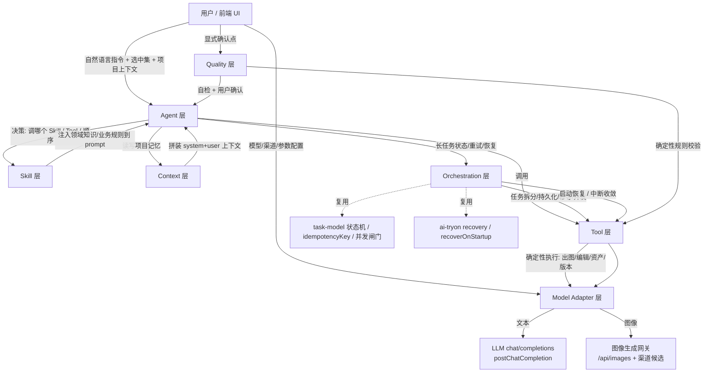

# V207-02 · 目标智能执行架构设计

> 配套 `V207-01`（现状审查）与 `V207-03`（决策表）。本设计**保留**被验证健康的确定性内核（任务状态机/幂等/重试/并发闸门/恢复），**改造**上层「智能执行」抽象（Agent/Skill/Tool/Context/Model Adapter）。不引入第二套 Provider/KEY/网关；Model Adapter 原则上复用现有 `postChatCompletion` / `/api/images` / 全局 KEY / 渠道目录。

---

## 0. 设计原则

1. **内核不变**：`task-model.js` 状态机、`orchestrator.js`、`image-concurrency.js`(全局 5 并发)、`ai-tryon/recovery.js` 的确定性执行与恢复逻辑**原样保留**，它们是本仓最成熟的部分。
2. **引入 Tool 抽象（当前缺失）**：把「出图/编辑/资产管理/任务 CRUD/版本切换」封装为**标准化、可组合、带权限边界**的 Tool，Agent 只能经 Tool 影响世界。
3. **Agent 从「提示词模板」升级为「受控决策者」**：仍基于 `postChatCompletion`，但增加（a）统一 Tool 调用契约、（b）明确的 model-decided vs code-decided 边界。
4. **Skill 运行时化**：从「构建期静态 import」升级为「运行时可发现/可组合/可扩展」的 Skill 注册表，但**不推翻现有 prompts 内容资产**（industry/*、core/* 继续复用）。
5. **Context 闭环**：把多轮编辑历史、版本链、上一版图、用户修改意图**回灌**进模型上下文（受控裁剪），支持断点续跑。
6. **Model Adapter 统一**：文本走 `postChatCompletion`，图像抽出一个**真正的图像适配器**（替代 `images.routes.js` 内联 baseLoop），两者共享 KEY/渠道/重试/可观测封装。
7. **用户可控**：模型/渠道/参数/创作方向/最终执行内容，均在 Tool 边界与确认点受控。

---

## 1. 目标架构图（Mermaid）



> **关键边界**：Agent 只产出「Skill 选择 + Tool 调用计划 + 参数」；Tool 是确定性代码世界入口；Model Adapter 是唯一的「模型/网关」出口。Agent 不直接 `fetch` 上游、不直接写库。

---

## 2. 七层职责定义

### 2.1 Agent 层
- **负责**：理解用户意图（自然语言 + 选中集 + 项目上下文），决定「调哪些 Skill、按什么顺序、调哪些 Tool、传什么参数」；产出结构化决策（JSON / function-call）。
- **不该负责**：直接调用上游模型网关、直接写库、直接出图、拼装领域知识（那是 Skill/Context 层的事）。
- **与相邻层传数据**：输入 = `InstructionInput{ instruction, selection, projectSnapshot, runState }`；输出 = `AgentPlan{ skillIds[], toolCalls[], rationale }`。
- **由模型决定**：意图理解、Skill 选择、Tool 顺序、参数初值。
- **必须确定性代码控制**：决策 JSON schema 校验、fail-closed 白名单（复用 `ai-canvas-agent.js` 的 `ACTION_CONTRACT` 思路）、最终执行前确认点。
- **需用户确认**：创作方向重大变更、不可幂等操作（删除/覆盖）、跨屏批量影响。
- **支持扩展**：新增「工作区」（详情/画布/换装）= 注册一个 AgentProfile（system 文案 + 可用 Tool/Skill 白名单），不改核心。

### 2.2 Skill 层
- **负责**：领域知识 + 稳定业务规则的**内容**（行业四字段、全局锁规则、文案/禁词、案例、方法论），并以**运行时可组合**方式注入 Agent/模型上下文。
- **不该负责**：执行、编排、模型调用、UI。
- **与相邻层传数据**：输入 = `SkillRequest{ industryId, platformId, taskStage, context }`；输出 = `SkillBundle{ systemAdditions[], userClauses[], deterministicRules[] }`。
- **由模型决定**：无（Skill 是内容供给，非推理）。
- **必须确定性代码控制**：Skill 选择算法（`getIndustryStrategy` 数据驱动继续复用）、组合顺序、注入裁剪。
- **支持扩展**：新增行业 = 注册 Skill 数据 + 在注册表登记（**继续数据驱动，业务代码不改**）；新增 Skill 类型 = 实现 `Skill` 接口并注册。**引入运行时注册表**替代当前构建期静态 import。
- **清理**：删除/降级 DEAD 资产（`reference-image-guide.md`、未消费的 `copywriting/methodology` 导出），让 `platform/`、`reference-image-roles.js`、`case-library.js` 从「仅门禁扫描」变为「被 Skill 运行时消费」或明确退役。

### 2.3 Context 层
- **负责**：项目级记忆的**可靠重建 + 受控历史回灌**，作为所有 Agent/模型调用的上下文真相源。
- **不该负责**：推理、执行、持久化原语（复用现有 `project-store.js`）。
- **与相邻层传数据**：输入 = `projectId + runId + scope(selection)`；输出 = `ContextBundle{ basic, goal, productData, referenceMeta, historyWindow[], editThreads[], pendingTasks[] }`。
- **由模型决定**：无。
- **必须确定性代码控制**：上下文窗口裁剪（长度护栏！当前缺失）、历史窗口大小、跨项目隔离（继续 `id` 白名单隔离）、`currentPlanRunId` 续跑状态机（**补全赋值逻辑**）。
- **需用户确认**：无（纯读取拼装）。
- **支持扩展**：新增工作区 = 扩展 `ContextBundle` schema（不破现有 project.json）。
- **修复 P3/P4**：把 `editThreads[]`/版本链/上一版图/修改意图**回灌**（`version-routes.js` 当前仅传 frozenPrompt，须改为带历史窗口）；`currentPlanRunId` 在规划启动时赋值、续跑时恢复。

### 2.4 Tool 层（当前缺失，重点建设）
- **负责**：把一切「影响世界的确定性操作」封装为标准化 Tool：出图、图编辑、资产管理、任务创建/查询/重试/恢复、项目读写、版本保存/切换/回滚、文件/数据操作。
- **不该负责**：意图理解、领域知识、模型调用（那是 Agent/Skill/Model Adapter 的事）。
- **与相邻层传数据**：统一 `ToolCall{ tool, args }` → `ToolResult{ ok, data, sideEffects[] }`。每个 Tool 声明 `permissions` / `idempotent` / `confirmRequired` / `sideEffectScope`。
- **由模型决定**：选哪个 Tool、传什么参数。
- **必须确定性代码控制**：Tool 实现本身（复用 `local-images-generator.js`/`version-store.js`/`project-store.js` 既有逻辑）、权限边界、幂等键、并发闸门（继续全局 5 并发）。
- **需用户确认**：`confirmRequired=true` 的 Tool（删除/覆盖/跨屏批量）。
- **支持扩展**：新增工具 = 实现 `Tool` 接口并注册；换装新能力（pose/master-fit/quality 之外）从「重写 AI 模块+路由」改为「注册一个 Tool + 一个 Skill 数据」（解决 P12）。

### 2.5 Orchestration 层
- **负责**：复杂任务拆解、多步组织、状态持久化、失败处理、断点恢复、重复执行去重、超时/中断处理、长任务进度与用户介入。
- **不该负责**：领域知识、提示词拼装、具体出图实现。
- **与相邻层传数据**：输入 = `Plan{ steps[] }`；输出 = `RunState{ stepStatus[], progress, resumeToken }`。复用 `task-model.js` 状态机、`idempotencyKey`、`recoverOnStartup`/`recovery.js`。
- **由模型决定**：任务拆解的子目标（可选，长任务可由 Agent 产出子目标树）。
- **必须确定性代码控制**：状态跃迁白名单（`canTransition`）、重试分类（`classifyError`）、退避、幂等、并发闸门、启动恢复（**绝不盲目重跑**）。
- **需用户确认**：`needs_confirm` 状态（`uncertain` 请求不自动重试）、断点恢复后的人工确认。
- **支持扩展**：新增工作区 = 复用同一编排内核，仅需声明 step 类型与 Tool 绑定。

### 2.6 Quality 层
- **负责**：商品事实 / 用户需求 / 提示词 / 图片结果 / 参考图一致性 / 跨屏视觉一致性 / 用户修改意图核对 / 结果验收与失败反馈，**参与执行闭环**。
- **不该负责**：领域知识供给（Skill 层）、执行。
- **与相邻层传数据**：输入 = `QualityInput{ artifact, context, industryStrategy }`；输出 = `QualityReport{ findings[], needsHuman, autoFix[] }`。
- **由模型决定**：主观判定（视觉/文案合规）。
- **必须确定性代码控制**：规则引擎（`checklist.js` 的禁词/叙事弧校验）、`MAX_AUTO_FIX` 上限。
- **需用户确认**：`needsHuman`、`needs_confirm`。
- **修复 P7**：质检必须收 `industryStrategy.promoBoundaries`（`qc-review.js:31-36` 当前漏传）。
- **支持扩展**：新增行业质检规则 = 在 Skill/Quality 注册，不改核心。

### 2.7 Model Adapter 层
- **负责**：统一封装「调模型」——超时、重试、JSON 抽取、KEY/渠道解析、可观测、降级。文本与图像**共用同一套适配语义**。
- **不该负责**：业务编排、提示词拼装、出图候选循环（那是 Tool/Orchestration 的事）。
- **与相邻层传数据**：输入 = `ModelRequest{ adapter, model, body, keySource, channelId, timeout, retries }`；输出 = `ModelResponse{ text/parsed, meta }`。
- **复用现有**：`postChatCompletion`（`ai-chat-shared.js:151`）作为文本适配器；**抽出图像适配器**（替代 `images.routes.js:223` 内联 baseLoop），两者共享 `resolveApiKey`（`image-error-policy.js:28`）+ `channel-config.js` + `image-concurrency.js` 并发闸门 + `image-error-policy.js` 的换线/变体重试判定。
- **结构性问题论证（E1）**：当前文本 `postChatCompletion` 仅 `fetch+readTextSafely`（`ai-chat-shared.js:151-163`），图像走 `images.routes.js` 内联约 180 行嵌套循环，**两套并行实现、图像侧无适配器、重试/换线耦合在路由 handler**（`P2/P10/P11`）。建议：把图像出图抽取为 `createImageAdapter()` 返回与 `postChatCompletion` 同构的 `generateImage(req)`（见 §3.3），**不新增 Provider/KEY/网关**，仅重组代码。

---

## 3. 关键接口建议（数据结构 + 调用签名，非实现）

### 3.1 Tool 契约（解决 P1）
```ts
interface Tool {
  id: string;
  description: string;            // 供 Agent 选择
  permissions: string[];          // 如 ['image:generate']
  idempotent: boolean;            // 决定是否走 idempotencyKey
  confirmRequired: boolean;       // 是否需用户确认
  sideEffectScope: 'project' | 'screen' | 'global';
  run(args: ToolArgs, ctx: RunCtx): Promise<ToolResult>;
}
// 调用签名
async function dispatchTool(call: ToolCall, ctx: RunCtx): Promise<ToolResult>;
```

### 3.2 AgentPlan 契约（解决 Agent 升级）
```ts
interface AgentPlan {
  skillIds: string[];             // 选用 Skill（如 'industry:apparel'）
  toolCalls: ToolCall[];          // 有序工具调用
  rationale: string;              // 供质量/审计
}
// 执行入口
async function executePlan(plan: AgentPlan, ctx: RunCtx): Promise<RunState>;
```

### 3.3 统一 Model Adapter（解决 P2）
```ts
interface ModelRequest {
  adapter: 'text' | 'image';
  model: string; channelId?: string;
  body: object;                   // 已由调用方组装好
  keySource: 'request' | 'settings';
  timeoutMs?: number; retries?: number;
}
interface ModelAdapter {
  complete(req: ModelRequest): Promise<ModelResponse>;
}
// 文本: postChatCompletion 包裹为 adapter
// 图像: 抽出 generateImage(req) 复用 channel-config + image-concurrency + image-error-policy
```

### 3.4 ContextBundle（解决 P3/P4）
```ts
interface ContextBundle {
  basic: { id; name; mode; note? };
  goal: { productText; customRequirements };
  productData; referenceMeta[];   // 仅元数据，像素按路径传
  historyWindow: EditRound[];    // 回灌多轮历史（受窗口裁剪）
  versionChain: VersionNode[];    // 上一版图引用
  pendingTasks: TaskState[];      // 未完成任务态（currentPlanRunId 驱动）
}
```

---

## 4. 四条链路在目标架构下的形态

- **A 详情创作**：Agent 加载 `industry:*` + `platform` Skill → 经 Tool 调 `analyze/director/compile/qc` 规划 Tool → 用户确认 → `batchGenerate` Tool（复用 orchestrator + 幂等 + 并发闸门）。Skill 真正进上下文，质检带 `industryStrategy`。
- **B 单屏连续编辑**：Context 层回灌 `editThreads`+版本链 → Agent 理解「上一版改了什么」→ 调 `editScreen` Tool（带历史窗口）→ 生成新版本 → `switchVersion` Tool 回滚。多轮上下文闭合。
- **C 无限画布**：前端传**选中集** → Context 层出 `selection` 快照（含图像 URL/缩略图或 vision 输入）→ Agent 经 Tool 调 `runCanvasGeneration`/`runOutfitNode`（**打通工具执行最后一跳**）→ 拓扑工作流引擎执行。复用 detail-studio 规划 Skill（不再自建极简 planner）。
- **D 服装换装**：`outfit-skill.js` 作为换装专属 Skill 注册入 Skill 层（保留其独立真相源，但经统一注册表暴露）；master-fit/pose/quality 三个分析进化为**三个 Tool + 三个 Skill 数据**，新增换装维度 = 注册而非重写模块；ai-tryon `execution.js` 桩（`analyzeInputs/postProcess/evaluateResult`）落地为 Orchestration 钩子。

---

## 5. 扩展机制小结

| 扩展场景 | 当前代价 | 目标架构代价 |
|---|---|---|
| 新增行业 | 加数据 + 注册 2~3 处（好） | 同左，且 Skill 进运行时注册表，更内聚 |
| 新增工作区（画布/换装） | 各自另写一套 Agent/Skill/路由 | 注册 AgentProfile + 复用 Tool/Orchestration/Model Adapter |
| 新增工具 | 无（散写业务模块） | 实现 `Tool` 接口 + 注册 |
| 新增换装 AI 维度 | 重写 AI 模块 + 路由（P12） | 注册 Tool + Skill 数据 |
| 新增质检规则 | 改 checklist + 可能的 qc-prompt | Skill/Quality 注册，核心不改 |
