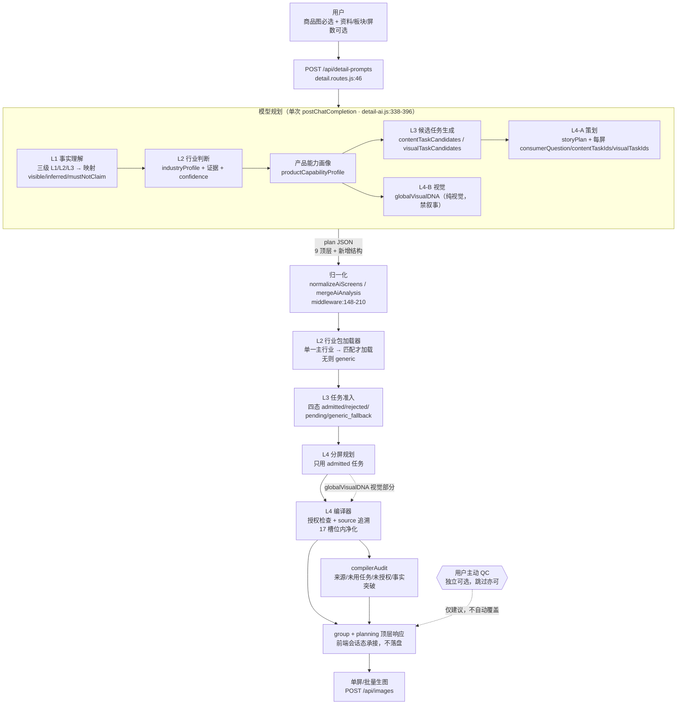

# V2-ARCH-002 · 四层控制架构设计（阶段 B）

> 任务来源：《JY-Canvas｜V2-ARCH-001 四层控制框架建设任务书》阶段 B，经《阶段 B—F 补充裁决与执行指令》正式启动。
> 执行：总控 AI（工程架构设计）。专业内容（8 基础 Skill 职责/推理规则、消费者营销策略、故事规划方法、行业知识正文、视觉艺术标准、最终提示词质量标准）由 ChatGPT 后续交付——**本文件不含也不定型这些内容**。
> 性质：**架构设计文档**，零业务代码改动。基于阶段 A（`V2-ARCH-001`）勘察，不重复勘察。
> 日期：2026-11-17　基准 HEAD：`ae786be`（阶段 A 提交后）。
> 关联裁决：D-PLAN-14-01（文档形态）、-02（三级事实 + 四态准入）、-03（统一测试集）、-04（奶渍/首屏文案）。

---

## 0. 阅读指引

本文件定义四层框架的**职责、边界、运行位置、数据流、降级与新旧映射**，是后续 V2-ARCH-003（数据契约）、004（行业包）、005（准入审计）的唯一架构依据。按裁决 D-PLAN-14-01，Markdown 供人理解，JSON/Schema 供运行时读取；**主规范唯一**，模块文件不得定义冲突规则。

---

## 1. 架构总览

### 1.1 四层不是四个 Agent / 四次调用

沿用已确认决策：一期**单次模型调用**（Owner 07:31 C-1）。四层是同一次详情规划流程中的**四道控制关卡**——有的在模型提示词内（逻辑约束），有的是确定性代码（工程断言）。不新增第二套模型网关、不建多 Agent 运行时。

| 层 | 名称 | 本质 | 主要运行位置 |
|---|---|---|---|
| L1 | 通用产品理解与事实控制 | 模型规划 + 确定性归一 | `detail-ai.js` instruction / `detail-middleware.js:173-210`（归一） |
| L2 | 行业识别与行业能力包 | 确定性路由为主 + AI 证据 | `detail-middleware.js:91-112` + 新增行业包加载器 |
| L3 | 内容/视觉任务准入控制 | **纯确定性**（新增） | 新增准入模块（规划结果 → 分屏规划之间） |
| L4 | 分屏规划与提示词编译 | 确定性编译 + 审计（新增约束） | `detail-middleware.js:467-713`（17 槽位内改造） |

### 1.2 完整数据流图



### 1.3 与现状的关键差异（一屏看懂要改什么）

| 现状（阶段 A 实测） | 目标（本架构） |
|---|---|
| 4 顶层字段在编译器出现 0 次 | 每字段有明确"产生→消费→是否进提示词"链路（见 V2-ARCH-003） |
| 行业包不按需加载，8 Skill 全挂/不挂 | 单一主行业 → 只加载匹配包 → 否则 generic |
| 无任务准入 | 内容/视觉任务分别四态准入 + 保留原因 |
| 编译无授权检查 | 编译器只用 admitted 任务 + compilerAudit 追溯 |
| 三段式叙事混进 visualStyle | globalVisualDNA 纯视觉，叙事归 storyPlan |

---

## 2. L1 · 通用产品理解与事实控制层

### 2.1 职责与边界
- **职责**：从商品图 + 用户输入提取可确认事实；建立来源与可信度记录；识别未知；在行业包缺失时提供安全通用边界。
- **不做**：不决定分屏、不判行业专业规则、不写营销表达。分层原则——"提供可信事实基础，不直接决定所有详情屏"。

### 2.2 输入输出
- 输入：`productImage`（必选）、`referenceImages`、`productFeature`、`sellingPoints`、`userInstruction`、`selectedSections`、`count`。
- 输出：`productFacts[]`（每项含 `factType/value/sourceType/confidence/status/sourceRef/allowedUse`）、`productCapabilityProfile`、`uncertainties[]`。

### 2.3 事实三级（裁决 D-PLAN-14-02）与运行时映射

| 裁决口径 | 含义 | 运行时枚举（不改 V219 收窄决策） | 使用规则 |
|---|---|---|---|
| L1 已确认 | 图片直接可见 / 标签明确可读 / 用户明确提供 | `visible` | 可作视觉与商品事实、进最终提示词 |
| L2 有限依据 | 有合理依据但不能完全确认 | `inferred` | 仅内部策划参考，须标注，不直接成功效承诺 |
| L3 未确认 | 信息不足 / 无证据的宣称 | `mustNotClaim` | 禁止进确定事实、卖点、最终提示词 |

- **映射是适配层，不是替换**：运行时仍只输出 `visible|inferred|mustNotClaim`（`planning-result.schema.json:59-63`），避免推翻 V219 §9 收窄决策与 G-2 边界；`detail-ai.js:45` 已存在六级→三级映射文本，本裁决三级映射替代该文本的同位置说明（具体改法见 V2-ARCH-007 变更清单）。
- **三级事实与四态准入是两个独立维度**（裁决明令不得混用）：事实三级描述"证据强度"，准入四态描述"任务是否可用"。

### 2.4 六类概念必须分离（阶段 A 缺口 → 本层硬约束）
`产品自身物理结构` / `产品包装材质` / `使用对象材质` / `适用范围` / `使用方式` / `使用效果`——分别建 `factType`，禁止写进同一个 `materials` 数组。直击真机"棉"材质错误（`middleware:198/592`）与功效扩大（`:569/612`）。

### 2.5 降级
- 模型未返回产品事实 → 回退本地 `buildProductAnalysis`（`middleware:262-290`），全部标 L2/L3，不幻想 L1。
- 图片无法读取 → `limitation` 字段说明，事实以用户输入为准，不编造。

---

## 3. L2 · 行业识别与行业能力包层

### 3.1 职责与边界
- **职责**：判**唯一生效主行业 ID**；证据不足进 `generic`；仅加载匹配行业包；把行业判断结果传给 L3/L4（不再让编译器另算一遍）。
- **不做**：不套用行业模板到具体产品；不在 generic 下加载所有行业包。

### 3.2 输入输出
- 输入：`productFacts[]`、`industryProfile`（AI 产出，含 evidence/confidence）、用户输入文本。
- 输出：`industryProfile`（统一单一决策源：`industryId/industryName/classificationEvidence/confidence/fallbackMode/loadedIndustryPackIds`）。

### 3.3 单一决策源原则（修复阶段 A P0-1）
- 现状双路径：`aiIndustry`（`middleware:102-112`）用 AI plan 文本 + `getIndustrySkillByText`（`detail-skills.js:403-412`）关键词计分；apparel 关键词含单字"包/面料/模特"（`:49`），"包装"命中服装。
- 目标：**展示行业 = 规则行业 = 加载包行业**，三处取同一个 `industryId`。强特征优先、弱语境词（衣物/包装/面料）不越权。
- 实现：AI `industryProfile.industryId` 为主判据 → 确定性加载器校验强特征 → 单一结果写入 `industryProfile` 并驱动后续；不再让 `buildGlobalLock` 用另一套 `industrySkill` 重新判（`middleware:481/422/427` 改为消费统一结果）。

### 3.4 行业包按需加载（机制，接口见 V2-ARCH-004）
- 只有 `loadedIndustryPackIds` 含当前行业时，行业规则才进 L3 准入与 L4 编译。
- `generic`：不加载任何行业包，只用 L1 事实控制 + L3 通用任务准入（阶段 D）。
- 清洁日化（`cleaning`）为首个接入对象：机制先建，专业正文由 ChatGPT 交付；G-2 词表（`detail-skills.js`）禁改，走新增覆盖层。

### 3.5 降级
- AI 未给 industryProfile 或 confidence 低 → 确定性关键词判定 + 强特征校验；仍不明确 → `generic`，`fallbackMode=generic_no_pack`。
- 禁止 generic 时套用其他行业观察点/禁忌（真机服装残留的根因）。

---

## 4. L3 · 内容任务与视觉任务准入控制层

### 4.1 职责与边界（阶段 A 完全缺失层）
- **职责**：把"内容任务"与"视觉任务"分开注册、分别准入；每个任务检查产品事实、适用条件、排除条件；输出四态 + 原因；写入结构化数据，不让模型"自行判断"。
- **不做**：不发明任务专业内容（ChatGPT 定）；不越过 L1 事实边界；不把用户偏好当通行证。

### 4.2 输入输出
- 输入：`productFacts[]`、`productCapabilityProfile`、`industryProfile` + 已加载行业包、`selectedSections`（用户偏好）、任务注册表。
- 输出：`contentTaskCandidates[]` / `visualTaskCandidates[]`（每项含 `taskId/taskType/admission/status/reason/requiredFactsSatisfied`）、`excludedTaskIds[]`。

### 4.3 四态准入（裁决 D-PLAN-14-02）

| 状态 | 含义 | 进入分屏？ |
|---|---|---|
| `admitted` | 事实与适用条件满足、无排除项 | 是 |
| `rejected` | 命中排除条件 / 不适用行业 / 无依据 | 否，记原因 |
| `pending` | 缺少必要事实，待补 | 否，记缺什么 |
| `generic_fallback` | 无行业包，采用安全通用任务 | 是（通用池） |

### 4.4 准入判定逻辑（确定性，伪代码）
```
function admitTask(task, facts, capability, industry, packs, userPrefs):
  if task.allowedIndustries 不含 industry.id: return rejected(行业不匹配)
  if any task.excludedConditions 命中 facts/capability: return rejected(命中排除)
  missing = task.requiredFacts.filter(f => !facts.hasVerified(f))
  if missing.length: return pending(missing)
  if industry.pack == null: return generic_fallback(task.allowGeneric)
  if userPrefs 指定冲突方向: return rejected(用户偏好不得突破事实边界)
  return admitted
```

### 4.5 任务注册表字段（机制；内容由 ChatGPT 填）
`taskId / taskType(content|visual) / allowedIndustries / requiredAttributes / requiredFacts / evidenceRequirements / excludedConditions / userOverridePolicy / outputRequirements`。首批只建少量可靠通用任务 + 清洁日化机制（阶段 D，V2-ARCH-004/005）。

### 4.6 "产品细节"防滥用（直击真机问题）
`产品整体外观` / `产品真实结构细节` / `使用对象细节` / `使用过程` / `效果证明` 分属不同视觉任务，**各自准入**。无真实结构依据时 `结构细节` 必须 `rejected`；衣物纤维/服装缝线不得冒充产品结构。用户偏好可提升优先级，但不得把 `pending/rejected` 翻成 `admitted`。

---

## 5. L4 · 分屏规划与提示词编译控制层

### 5.1 三阶段划分
- **A 详情策划** → `storyPlan`（整套主线/首屏定位/每屏 `consumerQuestion` / 递进 / 重复与缺失检测）。
- **B 视觉规划** → `globalVisualDNA`（**只含 palette/texture/lighting/cameraLanguage/ratio/tone/integrityLocks**，禁写"第一屏展示什么"）+ 每屏构图。
- **C 提示词编译** → 17 槽位内，只用 admitted 任务 + 已确认事实。

### 5.2 分屏规划如何用前三层结果
- 每屏 `screenId/screenRole/consumerQuestion/contentTaskIds/visualTaskIds/message/proof/copy/composition/constraints/assetRefs`。
- `contentTaskIds` / `visualTaskIds` **只能引用 L3 admitted（或 generic_fallback）任务 ID**；引用被拒任务即判编译违规。
- 首屏 hero 确定性绑定（`middleware:559-560` 已有）保留；标题与构图不写死（任务书第五节 #5）。

### 5.3 编译器授权与净化（任务书第六节）
- **只允许**：L1 确认/允许使用的事实、L3 admitted 任务、当前屏规划、globalVisualDNA 中真正影响画面的部分、用户明确视觉要求。
- **禁止**：策划分析原样输出、把消费者洞察写成解释段、重复堆营销、自动补未规划任务、自动加产品结构/材质/范围、空泛形容词（"高级/专业/有质感/强化购买欲"无执行方式者）。
- **字段不足时**：省略或用安全通用表达，**不让模型用废话补篇幅**。
- **编译审计**：每段重要指令记录 `sourceField` / `sourceTaskId`；无来源不得进入；`compilerAudit` 记录已规划任务、实际使用任务、未使用任务、是否添加未授权内容、事实约束是否突破。

### 5.4 四顶层字段如何真正进入编译（核心修复）
| 字段 | 现状 | 目标落点（进入 17 槽位的具体槽） |
|---|---|---|
| `industryProfile` | 编译器 0 次 | 经 L2 统一结果 → 槽 6 全局锁的"行业识别/观察点/禁忌"由它驱动（替换 `middleware:422/427` 的另算） |
| `consumerInsights` | 编译器 0 次 | 经 L4-A → 每屏 `consumerQuestion`（槽 2 模块任务/槽 8 卖点的"解决谁的问题"） |
| `marketingStrategy` | 编译器 0 次 | 经 L4-A → 槽 8 卖点、槽 9 文案的价值表达（受 L1 事实边界约束） |
| `globalVisualDNA` | 编译器 0 次 | 经 L4-B → 槽 7 风格锁、槽 15 构图光线（**只取视觉属性，不取叙事**） |

> 细节、产生/消费/持久化/缺失处理见 V2-ARCH-003。

### 5.5 降级
- 某字段缺失 → 该槽用安全通用表达或省略，不回退到写死模板、不编造。
- L3 无 admitted 内容任务 → 用 `generic_fallback` 通用任务；仍无 → 最小安全屏（商品真实展示 + 保守文案）。

---

## 6. 失败与降级策略汇总

| 失败点 | 降级动作 | 禁止 |
|---|---|---|
| 模型调用失败 | 现有 4 类重试 + 本地 `buildProductAnalysis` 兜底（`detail-ai.js:349-354`） | 不用 Mock 冒充真实质量 |
| 行业不明 | `generic` + `fallbackMode=generic_no_pack` | 不加载/套用其他行业包 |
| 行业包缺失 | L1 + L3 通用任务规划 | 不模仿其他行业结构 |
| 任务全部 pending/rejected | `generic_fallback` → 最小安全屏 | 不硬凑屏、不复制标题轮转 |
| 字段缺失 | 省略或通用表达 | 不用废话/策划语汇补篇幅 |
| 编译无来源指令 | 丢弃该指令 + 写审计 | 不偷偷加入 |

---

## 7. 现有代码 → 新架构映射

| 现有代码/资产 | 新架构角色 | 处理 |
|---|---|---|
| `detail-ai.js:338-396` 单次调用 | L1–L4-A/B 的模型规划阶段 | 保留调用结构，instruction 增四层约束（专业内容待 ChatGPT） |
| `detail-ai.js:24-50` 8 directive + 映射 | 8 基础 Skill 注入（内容待换） | 机制保留；专业内容由 ChatGPT 替换 |
| `detail-ai.js:45` 映射文本 | 三级事实映射适配层 | 按裁决 D-02 改为 L1/L2/L3→三枚举说明 |
| `detail.routes.js:46-114` | 请求入口 + planning 平级返回 | 基本不动；响应增审计字段（可选） |
| `normalizeAiScreens:148-171` | 规划→编译归一 | 扩展字段提取（现仅 13 项），补 `consumerQuestion/taskIds` 等 |
| `mergeAiAnalysis:173-210` | 事实归一 | 事实六分类拆字段，不再单 `materials` |
| `aiIndustry/getIndustrySkillByText` | L2 行业路由 | 改单一决策源 + 强特征优先 + cleaning 覆盖层 |
| `buildGlobalLock:418-429` | 槽 6 全局锁 | 行业段改消费统一 industryProfile |
| `buildDetailPromptGroup:467-713`（17 槽位） | L4-C 编译器 | **主改造点**：授权检查 + 净化 + 审计 + 四字段落槽 |
| `buildQualityChecklist` / `:622 slice(0,8)` | QC 文本 + 已知截断 | 去截断；用户主动 QC 仍独立（裁决 + 阶段 D） |
| 8 × SKILL.md + index.js 注册表 | 8 基础 Skill 资产 | 不返工、不重写；专业内容由 ChatGPT 交付后再换 |
| `planning-result.schema.json`（9 顶层） | 数据契约基底 | 扩字段（见 V2-ARCH-003），不推翻 9 顶层结构 |
| 10 类行业词表（G-2 禁改） | L2 词表基础 | 不改旧表，cleaning 走新增覆盖层 |

---

## 8. 架构不变量（模块文件不得违反）

1. 单次模型调用，不多 Agent、不第二套网关。
2. 主行业唯一；展示/规则/包行业同源。
3. 事实三级（L1/L2/L3）与准入四态独立，不混用。
4. 编译器只消费 admitted 任务；无来源不进提示词。
5. globalVisualDNA 只含视觉，storyPlan 只含叙事。
6. planning/selectedSections 仅内存，不落盘/不进 seed。
7. 旧版逐字节兼容、G-2 词表禁改、8 Skill 不返工。
8. 用户 QC 独立可选、不自动覆盖确认提示词；屏数硬约束；空板块自主规划。
9. 真实模型质量未测不标 PASS——架构通过 ≠ 生成质量通过。

---

## 9. 本阶段结论与后续

阶段 B 架构定义完成：四层职责/边界/运行位置/输入输出/数据流图/字段进编译链路/降级/新旧映射均已明确，满足任务书阶段 B 全部要点。

- 下一步：V2-ARCH-003（数据契约与接口说明），把本架构的每个字段落到"产生/消费/持久化/上下文/提示词/缺失处理"。
- 本阶段零业务代码改动；专业内容待 ChatGPT；S2-C 代码实施按 V2-ARCH-007 统一排期（先重叠检查、不绕过本契约）。
